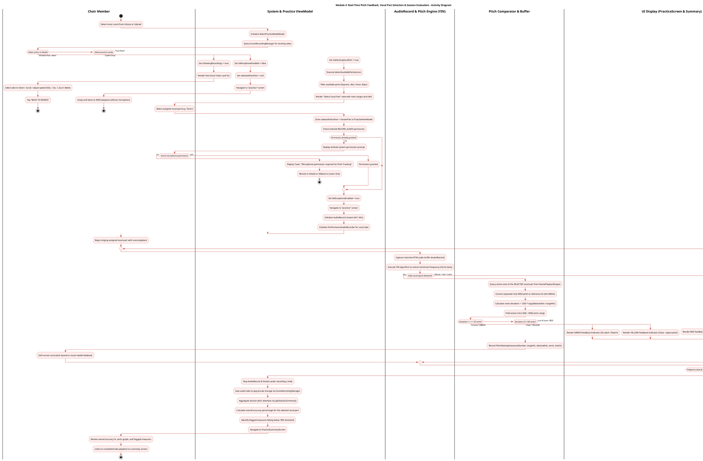
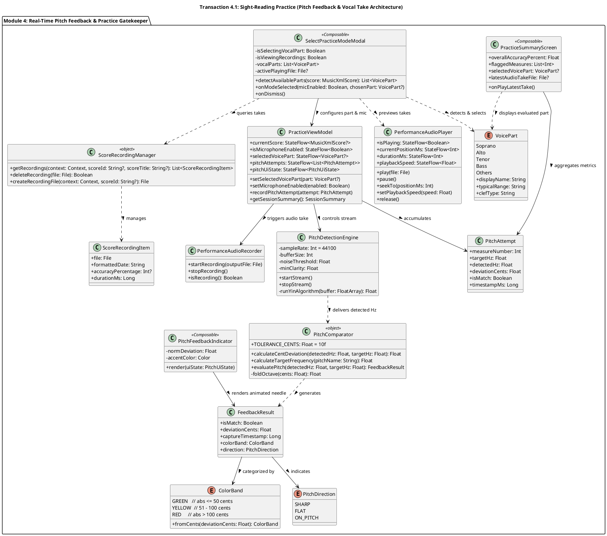
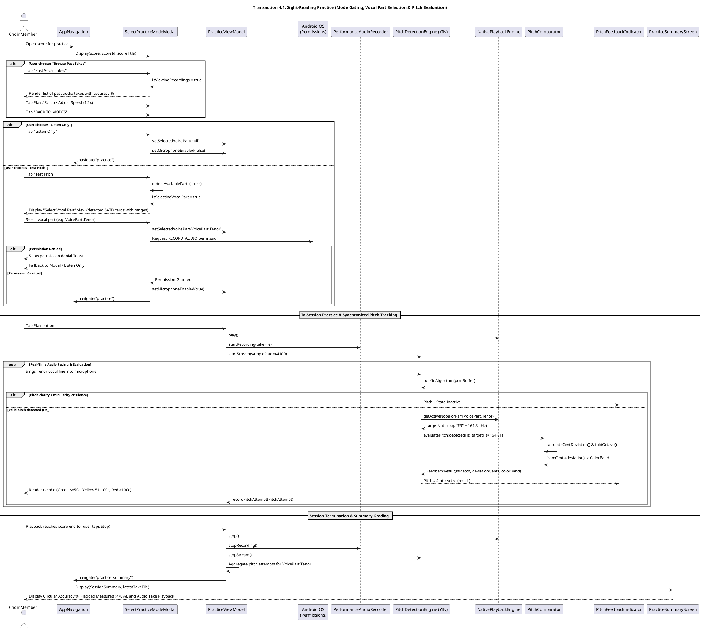

# VoxSight System Deliverables Revision Guide
## Architectural & Diagram Adjustments for Test Pitch Modal, Dynamic Vocal Part Selection, and Past Takes

> **Document Status**: Production-Aligned Specification Guide  
> **Source Commit Baseline**: `7799d11` (*feat(practice): add dynamic test pitch vocal part selection modal and streamline header layout*)  
> **Target Deliverables**: Software Requirements Specification (SRS), Software Design Document (SDD), Capstone Defense Presentation, and UI Screenshot/Wireframe Artifacts  
> **Target Files**:
> - [`mobile/app/src/main/java/com/cit/kaido/voxsight/ui/screens/practice/SelectPracticeModeModal.kt`](file:///C:/Projects/VoxSight/mobile/app/src/main/java/com/cit/kaido/voxsight/ui/screens/practice/SelectPracticeModeModal.kt)
> - [`mobile/app/src/main/java/com/cit/kaido/voxsight/ui/screens/practice/VoicePart.kt`](file:///C:/Projects/VoxSight/mobile/app/src/main/java/com/cit/kaido/voxsight/ui/screens/practice/VoicePart.kt)
> - [`mobile/app/src/main/java/com/cit/kaido/voxsight/ui/screens/practice/PracticeScreen.kt`](file:///C:/Projects/VoxSight/mobile/app/src/main/java/com/cit/kaido/voxsight/ui/screens/practice/PracticeScreen.kt)
> - [`mobile/app/src/main/java/com/cit/kaido/voxsight/ui/screens/practice/PracticeSummaryScreen.kt`](file:///C:/Projects/VoxSight/mobile/app/src/main/java/com/cit/kaido/voxsight/ui/screens/practice/PracticeSummaryScreen.kt)
> - [`mobile/app/src/main/java/com/cit/kaido/voxsight/ui/navigation/AppNavigation.kt`](file:///C:/Projects/VoxSight/mobile/app/src/main/java/com/cit/kaido/voxsight/ui/navigation/AppNavigation.kt)
> - [`mobile/app/src/main/java/com/cit/kaido/voxsight/audio/PerformanceAudioPlayer.kt`](file:///C:/Projects/VoxSight/mobile/app/src/main/java/com/cit/kaido/voxsight/audio/PerformanceAudioPlayer.kt)
> - [`mobile/app/src/main/java/com/cit/kaido/voxsight/storage/ScoreRecordingManager.kt`](file:///C:/Projects/VoxSight/mobile/app/src/main/java/com/cit/kaido/voxsight/storage/ScoreRecordingManager.kt)

---

## 1. Executive Summary: What Changed and Why It Matters

In earlier drafts of the **SRS** and **SDD**, the practice flow assumed a simple binary gatekeeper:
```text
[User selects score] -> [SelectPracticeModeModal] -> [Chooses "Test Pitch"] -> [Check mic permission] -> [PracticeScreen]
```
In this legacy flow, there was no specification of **which vocal part** the user intended to sing when testing their pitch. The pitch detection engine was implicitly comparing against notes without an upfront user-assigned SATB voice focus.

### The New Implemented Reality (Commit `7799d11`):
1. **Dynamic SATB Part Detection (`detectAvailableParts(score)`)**:
   Instead of hardcoding parts, `SelectPracticeModeModal` dynamically parses the loaded MusicXML score and displays only the vocal parts that actually exist in the score (e.g., Soprano, Alto, Tenor, Bass) along with their vocal pitch ranges (e.g., `C4 - A5`, `G3 - D5`, `C3 - G4`, `E2 - C4`) and clefs.
2. **Two-Step Modal State Machine (`isSelectingVocalPart`)**:
   Tapping **"Test Pitch"** does *not* immediately navigate or ask for permissions. It transitions the modal internally to the **"Select Vocal Part"** view where the singer must designate their voice part.
3. **Targeted Pitch Evaluation**:
   `PracticeViewModel.setSelectedVoicePart(chosenPart)` locks the pitch comparator and summary grading specifically to the notes of that selected vocal part.
4. **Deferred Permission Check**:
   Android's `RECORD_AUDIO` runtime permission prompt is launched only *after* the vocal part is chosen.
5. **Integrated Past Vocal Takes Hub (`isViewingRecordings`)**:
   The modal also acts as a performance archive, allowing users to browse prior recorded audio takes, listen with `PerformanceAudioPlayer`, scrub positions, toggle speed (0.8x, 1.0x, 1.2x), inspect historical accuracy percentages, and delete takes.

---

## 2. Deliverables Impact Matrix

| Deliverable | Specific Section / Diagram | Old Model | Revised Model (Commit `7799d11`) | Rationale |
| :--- | :--- | :--- | :--- | :--- |
| **SRS** | **Module 4 Use Case Diagram** | UC1 branches directly to "Listen & Study" and "Test Pitch". | "Test Pitch" includes `Select Assigned Vocal Part (Dynamic SATB Detection)`. Modal extends `Browse & Playback Past Vocal Takes`. | Captures the mandatory part selection and take browsing features in functional requirements. |
| **SRS** | **Module 4 Activity Diagram** | Test Pitch branch immediately verifies `RECORD_AUDIO` permission. | Inserts steps for `detectAvailableParts(score)`, user part selection, and `setSelectedVoicePart` prior to permission check. | Accurately models the user decision flow and system state initialization. |
| **SRS** | **Functional Requirements** | Generic pitch feedback without part attribution. | Add FR for Dynamic Part Selection and FR for Audio Take History/Playback. | Essential for traceability matrices and acceptance testing. |
| **SRS** | **In-App Screenshot Guide** | Single screenshot for `SelectPracticeModeModal.kt`. | Three distinct captures: Mode Selection (3a), Vocal Part Selection (3b), Past Vocal Takes (3c). | Reflects the 3 visual states of the new modal for capstone evaluation. |
| **SDD** | **Section 4.1 Component Catalog** | `SelectPracticeModeModal` described as simple 2-card dialog. | Documents 2-step modal flow, `VoicePart` enum, `ScoreRecordingManager`, and `PerformanceAudioPlayer`. | Complete architectural component accounting. |
| **SDD** | **Transaction 4.1 Class Diagram** | Shows basic `SelectPracticeModeModal` without part or audio dependencies. | Adds `VoicePart`, `ScoreRecordingManager`, `ScoreRecordingItem`, and `PerformanceAudioPlayer` relations. | Structural integrity of the software design. |
| **SDD** | **Transaction 4.1 Sequence Diagram** | User selects "Test Pitch" -> Modal verifies permission -> Launch. | User selects "Test Pitch" -> Modal displays SATB cards -> User selects part -> Modal sets part -> Verify permission -> Launch. | Reflects actual invocation order in `AppNavigation.kt`. |
| **SDD** | **Transaction 2.1 Alignment** | Part selection described only inside `PracticeScreen` via chips. | Note added that initial active part is pre-selected by the gatekeeper modal before screen initialization. | Eliminates state contradiction between Module 2 and Module 4. |

---

## 3. Revised SRS Diagrams (PlantUML)

### 3.1 Module 4: Real-Time Pitch Feedback — Use Case Diagram

```plantuml
@startuml
title Module 4: Real-Time Pitch Feedback & Session Evaluation - Use Case Diagram

left to right direction
skinparam actorStyle awesome
skinparam packageStyle rectangle
skinparam backgroundColor #FFFFFF

skinparam usecase {
  BackgroundColor #FDEDEC
  BorderColor #C0392B
  ArrowColor #C0392B
  FontSize 11
}
skinparam actor {
  BackgroundColor #FADBD8
  BorderColor #922B21
}

actor "Choir Member" as CM
actor "Device Microphone\n(AudioRecord Stream)" as MIC
actor "Pitch Detection Engine\n(YIN Algorithm)" as PDE
actor "Pitch Comparator &\nSession Buffer" as PCB
actor "Local Audio Storage\n(App Private Files)" as STORE

rectangle "Real-Time Pitch Feedback & Practice Gatekeeper Module" {
  ' Gatekeeper Mode Selection
  usecase "Open Practice Gatekeeper Modal\n(SelectPracticeModeModal)" as UC1
  usecase "Select Listen Only Mode\n(Mic Disabled, Study Flow)" as UC1a
  usecase "Select Test Pitch Mode\n(Mic Active, Pitch Evaluation)" as UC1b
  
  ' New Features from Commit 7799d11
  usecase "Select Assigned Vocal Part\n(Dynamic SATB Detection from Score)" as UC1b1
  usecase "Browse & Playback Past Vocal Takes\n(Take History, Accuracy % & Speed)" as UC1c
  usecase "Delete Past Vocal Take" as UC1c1

  ' Pitch Pipeline
  usecase "Request & Verify RECORD_AUDIO Permission" as UC2
  usecase "Stream Microphone PCM Audio" as UC3
  usecase "Detect Sung Frequency (Hz) via YIN" as UC4
  usecase "Compare Sung Pitch to Target Part Note" as UC5
  usecase "Render 3-Band Feedback Indicator\n(Green <=+/-50c / Yellow 51-100c / Red >100c)" as UC6
  usecase "Record Synchronized Vocal Take Audio" as UC7a
  usecase "Buffer Pitch Attempts in Memory" as UC7b
  usecase "Review Post-Session Pitch Summary\n(PracticeSummaryScreen)" as UC8
}

' User Interactions
CM --> UC1
CM --> UC8

' Modal branching
UC1 ..> UC1a : <<extend>>
UC1 ..> UC1b : <<extend>>
UC1 ..> UC1c : <<extend>>

' Test Pitch Flow: Must select part first, then request permission
UC1b  ..> UC1b1 : <<include>>
UC1b1 ..> UC2   : <<include>>

' Recording takes
UC1c ..> UC1c1 : <<extend>>
STORE --> UC1c
STORE --> UC7a

' Audio stream & Pitch pipeline
UC2  ..> UC3 : <<include>>
UC3  ..> UC4 : <<include>>
UC4  ..> UC5 : <<include>>
UC5  ..> UC6 : <<include>>
UC5  ..> UC7b : <<include>>
UC5  ..> UC7a : <<include>>

' Summary screen includes buffered attempts
UC7b ..> UC8 : <<include>>

' System Actor associations
MIC --> UC3
PDE --> UC4
PCB --> UC5
PCB --> UC7b

note right of UC1b1
  Score-Aware Detection:
  Dynamically filters available SATB
  parts (Soprano, Alto, Tenor, Bass)
  based on detectAvailableParts(score).
end note

note right of UC6
  Three-Band Feedback (PitchFeedbackIndicator.kt):
  GREEN  = deviation <= +/-50 cents (match)
  YELLOW = deviation 51-100 cents (close)
  RED    = deviation > 100 cents (miss)
  Evaluated on the user's SELECTED vocal part.
end note

@enduml
```



---

### 3.2 Module 4: Real-Time Pitch Feedback & Mode Flow — Activity Diagram



---

## 4. Revised SDD Diagrams (PlantUML)

### 4.1 Transaction 4.1: Class Diagram (Software Design Document)



---

### 4.2 Transaction 4.1: Sequence Diagram (Software Design Document)



---

## 5. Specific Text Updates for Deliverable Sections

### 5.1 Updates for `Revised_SRS_Diagrams_and_Wireframes_Guide (1).md`
1. **Section 4 Title & Overview**: Update the introductory description to explicitly mention:
   > *"The gatekeeper modal (`SelectPracticeModeModal.kt`) enforces a two-step configuration for pitch evaluation: users first choose Test Pitch, then select their target vocal part (dynamically extracted from the score's staves). The microphone stream is only engaged after part assignment, ensuring real-time feedback and post-session scoring are calibrated strictly against the user's vocal range."*
2. **Section 5 (Screenshot Guidelines)**: Update **Figure 3** to include three screenshots:
   - **Figure 3a (`SelectPracticeModeModal` - Modes & Takes)**: Shows the primary cards ("Listen Only", "Test Pitch") and the "Past Vocal Takes" button.
   - **Figure 3b (`SelectPracticeModeModal` - Vocal Part Selection)**: Shows the detected SATB voice cards (e.g. Soprano, Alto, Tenor, Bass with ranges like `C4-A5` and clef badges).
   - **Figure 3c (`SelectPracticeModeModal` - Past Vocal Takes)**: Shows the historical takes list with accuracy badges (e.g., `85% Acc`), scrub slider, and speed toggles (`0.8x`, `1.0x`, `1.2x`).

### 5.2 Updates for `Revised_Software_Design_Document.md`
1. **Section 4.1 Front-End Component Descriptions**:
   - Update `SelectPracticeModeModal` description with:
     > *"A Jetpack Compose dialog gating entry into `PracticeScreen`. Manages three primary internal states: (1) Practice Mode Selection (`Listen Only` vs `Test Pitch`), (2) Dynamic Vocal Part Selection (`isSelectingVocalPart = true`), which filters the score's vocal parts via `detectAvailableParts(score)` and requires the singer to assign their voice part before triggering the `RECORD_AUDIO` permission launcher, and (3) Past Vocal Takes view (`isViewingRecordings = true`), allowing review, scrubbed playback, speed toggling (0.8x/1.0x/1.2x), and deletion of saved audio takes."*
   - Add new component entry:
     > **Component Name:** `PerformanceAudioPlayer` & `PerformanceAudioRecorder` (`audio/`)  
     > **Description:** Audio capture and playback subsystem. `PerformanceAudioRecorder` records live vocal takes during Test Pitch sessions to `.m4a` files in app-private storage. `PerformanceAudioPlayer` supports seeking, variable speed (0.8x, 1.0x, 1.2x), and playback of past takes directly within the modal and summary screens.
2. **Transaction 2.1 Cross-Reference Note**:
   - In Section 2.1 (Select Voice Part and Apply Focus), add a note stating that when entering from Test Pitch mode, the initial active voice part is automatically set by `SelectPracticeModeModal`, ensuring audio isolation and visual focus match the singer's chosen vocal line immediately upon screen display.

---

## 6. Traceability Checklist for Capstone Documentation

When updating your final capstone deliverables, ensure the following cross-document consistencies:
- [ ] **SRS Section 3.4 (Functional Requirements)**: Ensure FRs list both *Dynamic SATB Part Detection* and *Audio Take Recording/Playback*.
- [ ] **SRS Section 4.1 & 4.2 (Diagrams)**: Replace legacy pitch use case and activity diagrams with the PlantUML diagrams from Section 3 of this document.
- [ ] **SDD Section 4.1 (Design Transactions)**: Update Transaction 4.1 Class Diagram and Sequence Diagram with the PlantUML code in Section 4 of this document.
- [ ] **SDD Appendix / Wireframes**: Replace single mode modal wireframe with the 3 distinct modal screens (Modes, Vocal Parts, Past Takes).
- [ ] **Presentation Slides**: When presenting the practice flow, highlight the **score-aware vocal part selection** as an innovative usability feature ensuring fair, part-accurate pitch grading.
