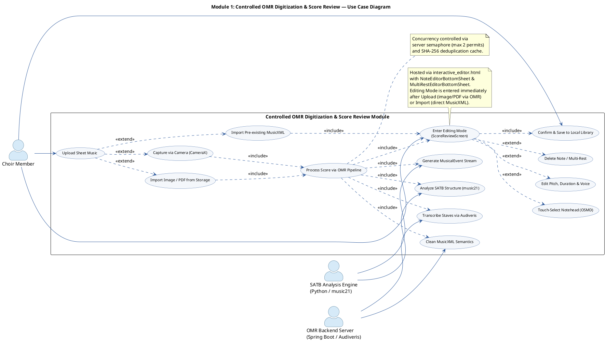
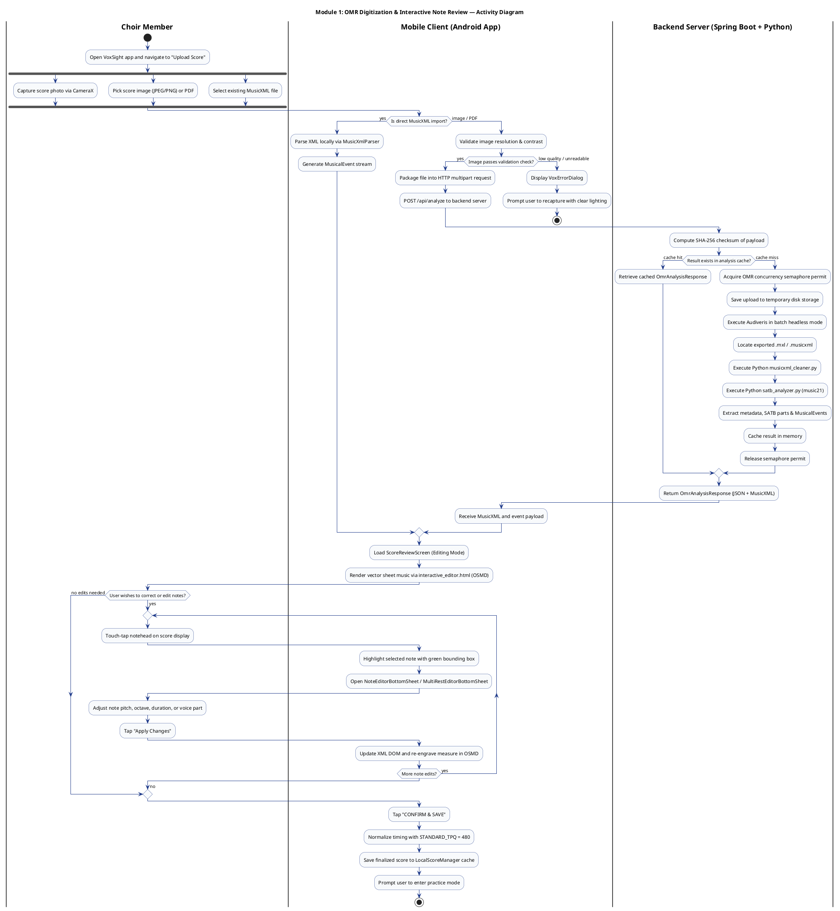
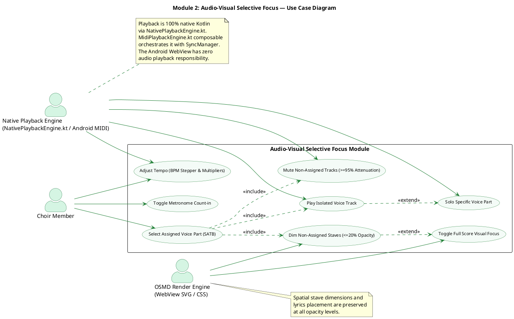
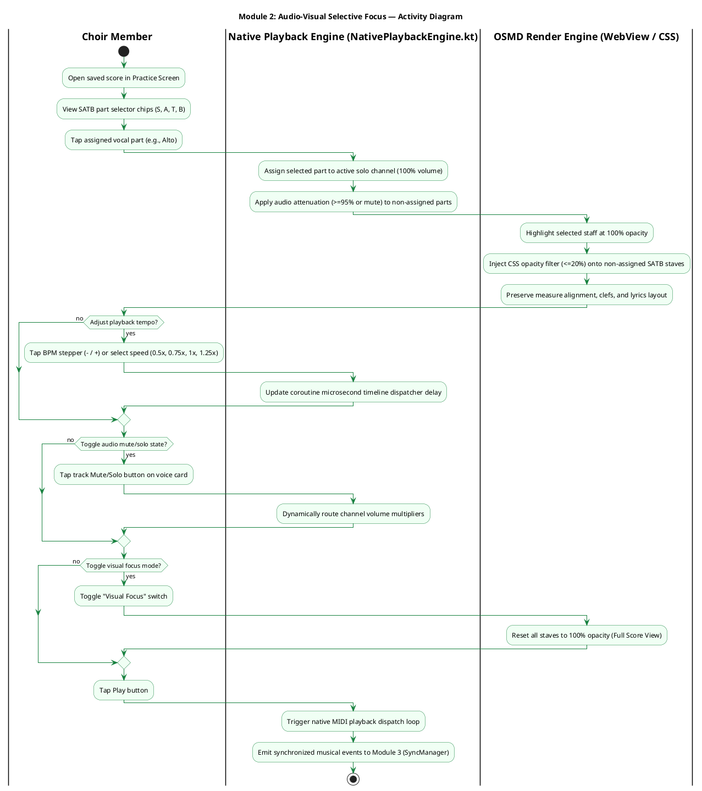
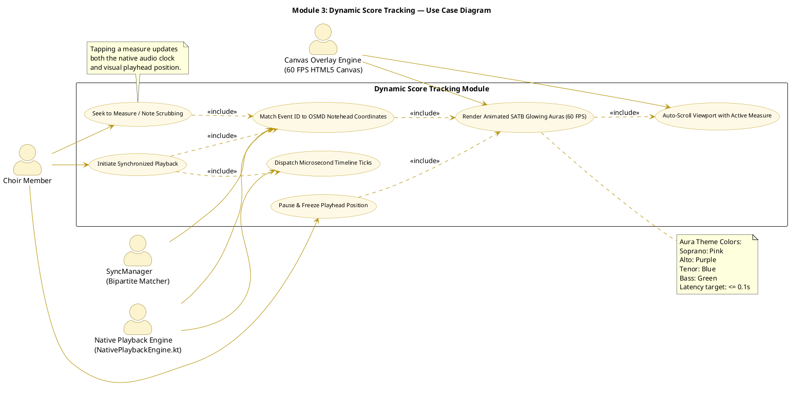
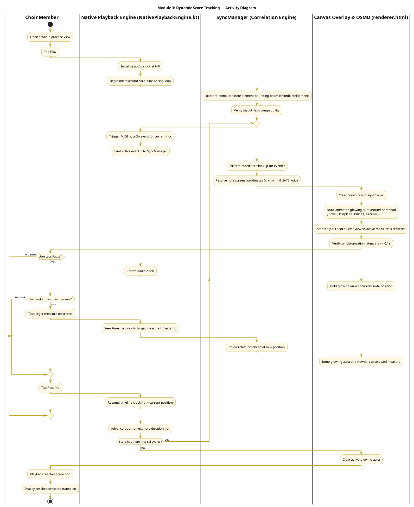
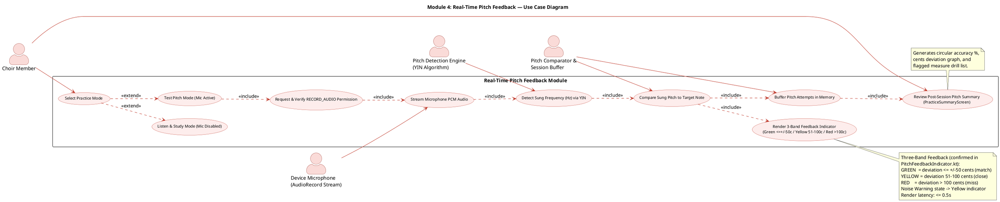
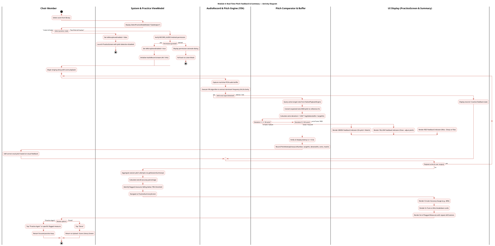

# VoxSight Revised SRS Diagrams & In-App Screenshot Guide

> **Document Status**: Production-Aligned Revision (v2 — Fully Verified)
> **Source Baseline**: Software Requirements Specification.md
> **Target Systems**: Kotlin Android Client (mobile/), Spring Boot OMR Backend (voxsight/), Audiveris Machine Vision, and Python music21 Analysis Engine.
> **Note**: This document leaves the original SRS file intact and provides the corrected, fully synchronized UML diagrams (PlantUML) and practical in-app screenshot instructions reflecting the real implementation.

---

## Executive Summary of Identified Discrepancies & Corrections

| Item / Dimension | Legacy SRS Specification | Current Implemented Architecture | Correction in Revised Diagrams |
| :--- | :--- | :--- | :--- |
| **Audio Synthesis Engine** | "Tone.js hosted inside Android WebView using human Aahs/Oohs soundfonts" | **Native Android MIDI & Kotlin Coroutines Pacing (NativePlaybackEngine.kt)** | WebView has **zero audio responsibility**. The audio clock runs natively via NativePlaybackEngine; Tone.js is completely replaced. |
| **Score Digitization Pipeline** | Monolithic "OMR Engine" returning MusicXML directly to playback | **Multi-Stage Pipeline**: Spring Boot (OmrController) → Audiveris → Python XML Cleaner → Python SATB Analyzer (music21) → Mobile Parser | Explicitly documents Audiveris transcription, semantic XML cleaning, SATB voice classification, confidence scoring, and event generation. |
| **Post-Upload Score Review & Editing** | Passive preview where user simply "confirms or re-uploads" | **Interactive Note Editor (ScoreReviewScreen.kt + interactive_editor.html)** — occurs **immediately after import/upload** before practice | Editing Mode is now correctly placed **directly after** the Import/Upload step in both diagrams. |
| **Dynamic Score Tracking** | Tone.js advances playhead in JS | **SyncManager.kt + HTML5 Canvas (renderer.html)** | Audio pacing loop via NativePlaybackEngine emits event IDs; SyncManager correlates with OSMD notehead coordinates; 60 FPS Canvas renders SATB glowing auras. |
| **Pitch Detection Engine** | FFT / Generic pitch engine | **YIN Algorithm (PitchComparator.kt)** | **Three-band feedback** (Green ≤ ±50¢, Yellow 51–100¢, Red > 100¢) confirmed in PitchFeedbackIndicator.kt. |
| **Practice Mode Gatekeeper** | Missing from early module flow | **SelectPracticeModeModal.kt** | Explicitly models mode selection ("Listen & Study" vs "Test Pitch & Practice") and RECORD_AUDIO permission gating. |
| **Playback Engine Class Name** | — | **MidiPlaybackEngine.kt** (composable) orchestrates NativePlaybackEngine and SyncManager internally | All diagram annotations now reference correct class names as found in codebase. |
| **Wireframes / Visuals** | Static low-fidelity wireframe sketches | **Production Screens & In-App Screenshot Guidelines** | Provides exact screen routes, component states, and capture checklists from the live mobile app. |

---

## 1. Module 1: Controlled OMR Digitization & Score Review

### 1.1 Revised Use Case Diagram

* **Boundary**: `Controlled OMR Digitization & Interactive Score Review`
* **Primary Actor**: `Choir Member`
* **Secondary Actors**: `OMR Server (Audiveris)`, `SATB Analysis Service (Python / music21)`

> **Correction from v1**: The Editing Mode (Interactive Score Review) is now correctly modeled as directly following the Upload step. After OMR processing returns the score (or after a direct MusicXML import), the system **always** routes the user through the ScoreReviewScreen before confirming and saving. This matches the actual app flow in UploadScoreScreen.kt and ScoreReviewScreen.kt.

### 1.2 Revised Activity Diagram

* **Partitions**: `|Choir Member|`, `|Mobile Client (Android App)|`, `|Backend Server (Spring Boot + Python)|`

> **Correction from v1**: The non-standard `-> Jump to Review;` PlantUML syntax has been replaced with proper conditional flow. Both the direct MusicXML path and the OMR path now converge correctly at `Load ScoreReviewScreen`.

---

## 2. Module 2: Audio-Visual Selective Focus & Voice Part Isolation

### 2.1 Revised Use Case Diagram

* **Boundary**: `Audio-Visual Selective Focus Module`
* **Primary Actor**: `Choir Member`
* **Secondary Actors**: `Native Playback Engine (Android MIDI)`, `OSMD Render Engine (WebView)`

> **Correction from v1**: The `Choir Director` secondary actor from the original SRS has been removed — the implemented application does not include any Choir Director role. The metronome count-in feature is retained as it is present in the UI (PracticeScreen.kt).

### 2.2 Revised Activity Diagram

* **Partitions**: `|Choir Member|`, `|Native Playback Engine (NativePlaybackEngine.kt)|`, `|OSMD Render Engine (WebView / CSS)|`

---

## 3. Module 3: Dynamic Score Tracking & Real-Time Synchronization

### 3.1 Revised Use Case Diagram

* **Boundary**: `Dynamic Score Tracking Module`
* **Primary Actor**: `Choir Member`
* **Secondary Actors**: `Native Playback Engine`, `SyncManager`, `HTML5 Canvas Overlay`

> **No structural changes from v1** — this diagram accurately reflects the implementation.

### 3.2 Revised Activity Diagram

* **Partitions**: `|Choir Member|`, `|Native Playback Engine (NativePlaybackEngine.kt)|`, `|SyncManager (Correlation Engine)|`, `|Canvas Overlay & OSMD (renderer.html)|`

---

## 4. Module 4: Real-Time Pitch Feedback & Assessment

### 4.1 Revised Use Case Diagram

* **Boundary**: `Real-Time Pitch Feedback Module`
* **Primary Actor**: `Choir Member`
* **Secondary Actors**: `Device Microphone (AudioRecord)`, `Pitch Detection Engine (YIN)`, `Pitch Comparator`

> **Correction from v1**: The feedback color bands have been corrected to **three bands** (Green / Yellow / Red) as confirmed in PitchFeedbackIndicator.kt (lines 52-54: GreenAccent, YellowAccent, RedAccent). The v1 diagram incorrectly showed only two bands (Green / Red).

### 4.2 Revised Activity Diagram

* **Partitions**: `|Choir Member|`, `|System & Practice ViewModel|`, `|AudioRecord & Pitch Engine (YIN)|`, `|Pitch Comparator & Buffer|`, `|UI Display (PracticeScreen & Summary)|`

> **Correction from v1**: Added the YELLOW (close, 51-100 cents) branch to the activity diagram, matching the three-band implementation in PitchFeedbackIndicator.kt.

---

## 5. In-App Screenshot Guide (Replacing Legacy Wireframes)

Because all core modules in VoxSight are fully implemented, functional screenshots captured directly from an Android device or emulator provide a far more accurate representation than conceptual mockups. Use the table below to capture and embed each screen.

### Screenshot Inventory & Capture Checklist

| Figure # | Documentation Section | Screen Name & Route in Code | Exact Source File | Specific State to Capture |
| :---: | :--- | :--- | :--- | :--- |
| **Figure 1** | Module 1: Controlled OMR Digitization | **Upload & Score Library Screen** | [UploadScoreScreen.kt](file:///c:/Users/elvin/OneDrive/Documents/Capstone%20-%20Final/VoxSight/mobile/app/src/main/java/com/cit/kaido/voxsight/ui/screens/upload/UploadScoreScreen.kt) | Top app bar with user profile icon & tour guide button. "Take Photo" (CameraX) and "Upload Music Sheet" action cards. Populated "Your Scores" list with saved score cards. |
| **Figure 2** | Module 1: Editing Mode | **Interactive Score Review & Note Editor Screen** | [ScoreReviewScreen.kt](file:///c:/Users/elvin/OneDrive/Documents/Capstone%20-%20Final/VoxSight/mobile/app/src/main/java/com/cit/kaido/voxsight/ui/screens/upload/ScoreReviewScreen.kt) / [NoteEditorBottomSheet.kt](file:///c:/Users/elvin/OneDrive/Documents/Capstone%20-%20Final/VoxSight/mobile/app/src/main/java/com/cit/kaido/voxsight/ui/screens/upload/NoteEditorBottomSheet.kt) | Top bar with "CANCEL" and "CONFIRM & SAVE" buttons. OSMD vector score at 0.55 zoom. One active note highlighted with green touch box. Open bottom sheet showing pitch, octave, duration chips, and "Delete Note". |
| **Figure 3** | Module 4: Real-Time Pitch Feedback | **Practice Mode Selection Modal** | [SelectPracticeModeModal.kt](file:///c:/Users/elvin/OneDrive/Documents/Capstone%20-%20Final/VoxSight/mobile/app/src/main/java/com/cit/kaido/voxsight/ui/screens/practice/SelectPracticeModeModal.kt) | Clean dialog overlay (90% screen width, rounded corners). "Listen & Study" card (Headphones icon). "Test Pitch & Practice" card (Microphone icon). |
| **Figure 4** | Modules 2 & 3: Focus & Tracking | **Unified Interactive Practice Screen** | [PracticeScreen.kt](file:///c:/Users/elvin/OneDrive/Documents/Capstone%20-%20Final/VoxSight/mobile/app/src/main/java/com/cit/kaido/voxsight/ui/screens/practice/PracticeScreen.kt) | Active playback with selected vocal part highlighted. Stave dimming visible. Real-time glowing SATB aura on active notehead. Live PitchFeedbackIndicator showing GREEN / YELLOW / RED. Bottom transport controls: BPM stepper, tempo multiplier, Play/Pause. |
| **Figure 5** | Module 4: Real-Time Pitch Feedback | **Post-Session Practice Summary Screen** | [PracticeSummaryScreen.kt](file:///c:/Users/elvin/OneDrive/Documents/Capstone%20-%20Final/VoxSight/mobile/app/src/main/java/com/cit/kaido/voxsight/ui/screens/practice/PracticeSummaryScreen.kt) | Circular Accuracy Percentage Donut (e.g., 85%). Pitch breakdown metrics (In-Tune, Miss, avg cents deviation). Scrollable Flagged Measures list. "Practice Again" and "Back to Library" buttons. |

---

### Step-by-Step Instructions to Capture Screenshots

1. **Launch the Application**:
   * Open the project in Android Studio and run on an Android device or emulator (Pixel 6/7/8 recommended).
   * Ensure the Spring Boot backend (voxsight/) is running (`.\\mvnw.cmd spring-boot:run`) or connected to the production cloud endpoint.

2. **Capturing Figure 1 (Upload & Library)**:
   * Log in to reach the main home screen (UploadScoreScreen).
   * Ensure at least one score exists in the library.
   * Use device screenshot buttons (Power + Volume Down) or Android Studio's screenshot tool.

3. **Capturing Figure 2 (Editing Mode — Score Review & Note Editor)**:
   * Upload an image or open a score to reach ScoreReviewScreen — this is the **Editing Mode** screen that appears **immediately after** OMR processing or direct MusicXML import.
   * Tap any notehead on the sheet music to bring up the green selection bounding box and trigger NoteEditorBottomSheet.
   * Take the screenshot with the bottom sheet raised and note options visible.

4. **Capturing Figure 3 (Mode Selection Gatekeeper)**:
   * From the score library, tap a score card to start practice.
   * The SelectPracticeModeModal dialog will appear on screen.
   * Take the screenshot while both "Listen & Study" and "Test Pitch & Practice" cards are displayed.

5. **Capturing Figure 4 (Unified Practice Screen)**:
   * Select "Test Pitch & Practice" (grant microphone permission if prompted).
   * Press Play and sing the target pitch so the live PitchFeedbackIndicator is active.
   * Capture the screen during active playback to demonstrate the glowing note aura, stave dimming, and the three-color feedback indicator simultaneously.

6. **Capturing Figure 5 (Practice Summary)**:
   * Allow playback to complete or tap Pause then "End Session".
   * The PracticeSummaryScreen will render with performance analytics and flagged measures.
   * Take the screenshot ensuring the circular gauge and flagged measure cards are in view.

---

## Appendix: Summary of All Corrections Made in v2

| Diagram | v1 Issue | v2 Fix |
| :--- | :--- | :--- |
| **Module 1 Use Case** | "Editing Mode" (ScoreReviewScreen) was not correctly positioned after Import/Upload | Added UC3 "Enter Editing Mode" as a mandatory step after both the OMR path (UC2 ..> UC3) and the direct MusicXML import path (UC1c ..> UC3) |
| **Module 1 Use Case** | UC4 "Confirm & Save" actor connection was incomplete | Added CM --> UC4 to reflect user explicitly tapping "CONFIRM & SAVE" |
| **Module 1 Activity** | Non-standard `-> Jump to Review;` PlantUML syntax for MusicXML direct path | Replaced with proper conditional flow that converges both paths at "Load ScoreReviewScreen" |
| **Module 2 Use Case** | Choir Director actor was listed (from original SRS) but does not exist in implementation | Removed Choir Director; kept only actors present in actual codebase |
| **Module 2 Activity** | Referenced generic "Kotlin / Android MIDI" engine | Updated all lane labels to reference NativePlaybackEngine.kt specifically |
| **Module 4 Use Case** | Only GREEN / RED two-band feedback was shown | Updated to three-band (GREEN / YELLOW / RED) confirmed in PitchFeedbackIndicator.kt |
| **Module 4 Activity** | Missing YELLOW (51-100 cents) branch in the activity flow | Added else if (Deviation 51-100 cents?) branch rendering YELLOW indicator |
| **Screenshot Guide** | Figure 2 caption did not mention "Editing Mode" or clarify when this screen appears | Updated caption and capture instructions to state Editing Mode appears immediately after upload/import |
