## CEBU INSTITUTE OF TECHNOLOGY

**UNIVERSITY**

COLLEGE OF COMPUTER STUDIES

**Software Design Description**

## for

## VoxSight

# Change History Signature

| Version | Description | Date Completed |
| :---- | :---- | :---- |
| 0.1 | Initial Release | May 12, 2026 |
| 1.0 | Revised: Aligned with final implemented architecture | September 30, 2026 |

---

# Preface

**Project Background.**

VoxSight was conceived to address a common challenge in choral music: the steep learning curve amateur singers face when transitioning from a physical sheet of music to an accurate vocal performance. Traditional practice methods often lack immediate, objective feedback, leading to the reinforcement of pitch errors. VoxSight bridges this gap by transforming static scores into interactive, data-driven practice sessions.

**Intent of this Document.**

This Software Design Description (SDD) serves as the definitive technical roadmap for the VoxSight mobile application. This is a production-aligned revision (v1.0) of the original SDD (v0.1), updated to accurately reflect the system as fully implemented. All diagrams, component descriptions, and data designs have been cross-referenced against the actual source code.

**Intended Audience:**

- **Software Developers:** For implementing the Kotlin/Android client, the Spring Boot orchestration backend, and the Python-based OMR processing utilities.
- **System Architects:** To verify the integration between the mobile client and the OMR engine.
- **Quality Assurance (QA) Teams:** To derive test cases based on the defined technical constraints (e.g., the ±10 cents pitch tolerance and <100ms synchronization latency).

**Document Organization:**

**Module 1:** The digitization of physical scores via OMR and the interactive score review/editing workflow.

**Module 2:** The native MIDI audio synthesis and selective isolation of SATB vocal parts.

**Module 3:** The synchronization of the visual score highlight with the native audio clock.

**Module 4:** The real-time frequency analysis and pitch feedback loop.

**Revision Notes (v0.1 to v1.0):**

| Area | Original Design (v0.1) | Actual Implementation (v1.0) |
| :--- | :--- | :--- |
| Audio Engine | Tone.js (JavaScript in WebView) using Aahs/Oohs soundfonts | Native Android MIDI via `NativePlaybackEngine.kt` using GM Piano (program 0) |
| OMR Pipeline | Single monolithic OMRIntegrationService | Multi-stage: `OmrController.java` -> Audiveris subprocess -> Python `musicxml_cleaner.py` -> Python `satb_analyzer.py` (music21) |
| Score Review | Passive confirmation step | Full interactive note editor (`ScoreReviewScreen.kt` + `interactive_editor.html`) entered immediately after upload/import |
| Score Rendering | Generic Canvas "Score Viewer" | Open Sheet Music Display (OSMD) in a WebView, bridged by `VoxSightJsBridge` |
| Sync Engine | PlayheadSynchronizer class | `SyncManager.kt` with bipartite coordinate correlation; 60 FPS HTML5 Canvas overlay |
| Pitch Engine | TarsosDSP library | Native Kotlin YIN algorithm (`PitchDetectionEngine.kt`), no third-party DSP library |
| Pitch Tolerance | +/-5 cents (match), 2-band feedback | +/-10 cents (isMatch), 3-band display: Green <=+/-50c, Yellow 51-100c, Red >100c |
| Data Persistence | Supabase PostgreSQL for all data | Local `LocalScoreManager.kt` for scores; Supabase for user auth metadata only |
| Session Metrics | POST /api/session/save to backend | In-memory List<PitchAttempt> aggregated at session end, no backend call |
| Choir Director role | Referenced in original SRS/SDD | Not implemented — single user type: Choir Member |

---

# Introduction

## 1.1 Purpose

The purpose of this Software Design Description (SDD) is to detail the architectural and component-level design of the VoxSight mobile application. This document translates the requirements established in the VoxSight Software Requirements Specification (SRS) into a concrete technical blueprint reflecting the **actual final implementation**.

## 1.2 Scope

This document covers the design of VoxSight, an Android-based mobile application for amateur choir members. It encompasses the client-side Kotlin/Compose app, a WebView hybrid layer for score rendering, the Spring Boot server-side API, integration with the Audiveris OMR engine and Python music21 scripts, and local data persistence. It details the four core modules.

## 1.3 Definitions and Acronyms

**Acronyms:**

**API** — Application Programming Interface | **BPM** — Beats Per Minute | **ERD** — Entity Relationship Diagram | **GM** — General MIDI | **Hz** — Hertz | **MIDI** — Musical Instrument Digital Interface | **MusicXML** — Music Extensible Markup Language | **OMR** — Optical Music Recognition | **OSMD** — Open Sheet Music Display | **PK / FK** — Primary Key / Foreign Key | **SATB** — Soprano, Alto, Tenor, Bass | **SDD** — Software Design Description | **SRS** — Software Requirements Specification | **TLS** — Transport Layer Security | **TPQ** — Ticks Per Quarter note | **UI/UX** — User Interface / User Experience | **UUID** — Universally Unique Identifier | **YIN** — A pitch detection algorithm

**Definitions:**

**Cents** — A logarithmic unit of musical intervals. 100 cents = one semitone. VoxSight uses 3-band feedback: Green <=+/-50c (isMatch at <=10c), Yellow 51-100c, Red >100c.

**ColorBand** — Enum in `PitchModels.kt` (GREEN, YELLOW, RED) derived by `ColorBand.fromCents()`.

**EventStream** — Data model encapsulating a sorted, indexed list of `MusicalEvent` objects for playback dispatch.

**MusicalEvent** — Data object containing: eventId, tickPosition, durationTicks, pitchMidi, pitchName, staffVoice.

**NativePlaybackEngine** — Kotlin class managing native Android MIDI playback via Android's built-in GM synthesizer. Replaces the original Tone.js design.

**Octave Normalization (Folding)** — Technique in `PitchComparator.kt` folding raw cents deviation into [-600, +600], allowing correct pitch class in a different octave to be treated as a match.

**SyncManager** — Kotlin class correlating `NativePlaybackEngine` event IDs to OSMD notehead screen coordinates for 60 FPS highlight rendering.

**Standard TPQ** — 480 ticks per quarter note. All parsed MusicXML events are normalized to this resolution before playback.

**Sync Drift** — Discrepancy between audio clock and UI render clock. VoxSight targets < 0.1 seconds.

## 1.4 References

\[1\] E. O. Lagamo Jr. et al., "Software Requirements Specification for VoxSight," CIT-U, 2026.

\[2\] Audiveris, "Audiveris OMR Engine," GitHub, 2024.

\[3\] W3C, "MusicXML 4.0 Specification," Jun. 2021.

\[4\] Google, "Jetpack Compose Documentation," Android Developers.

\[5\] Supabase, "Supabase Architecture and API Reference."

\[6\] OSMD, "Open Sheet Music Display," GitHub.

\[7\] A. de Cheveigné and H. Kawahara, "YIN, a fundamental frequency estimator," J. Acoust. Soc. Am., 2002.

---

# Architectural Design

**VoxSight System Architecture Block Diagram**

```plantuml
@startuml
!theme plain
skinparam componentStyle rectangle
skinparam linetype ortho
skinparam nodesep 40
skinparam ranksep 50
skinparam RoundCorner 8
skinparam component { BackgroundColor #F8F9FA; BorderColor #495057; ArrowColor #2980B9 }
skinparam node { BorderColor #343A40 }
title VoxSight System Architecture (v1.0 — Production Aligned)

actor "Choir Member" as User

node "Mobile Client (Android)" as Mobile {
  package "Jetpack Compose UI" {
    component "UploadScoreScreen" as UploadUI
    component "ScoreReviewScreen\n(Note Editor)" as ReviewUI
    component "PracticeScreen\n(SATB + Feedback)" as PracticeUI
  }
  package "WebView Layer (JavaScript)" {
    component "interactive_editor.html\n(OSMD + Note Editor)" as EditorWV
    component "renderer.html\n(OSMD + 60fps Canvas)" as RendererWV
  }
  package "Native Kotlin Engine" {
    component "NativePlaybackEngine.kt\n(Android MIDI)" as NPE
    component "SyncManager.kt\n(Event Correlator)" as Sync
    component "PitchDetectionEngine.kt\n(YIN)" as PDE
    component "PitchComparator.kt\n(3-Band Feedback)" as PC
    component "LocalScoreManager.kt" as LSM
    component "MidiPlaybackEngine.kt\n(Compose Orchestrator)" as MDE
  }
}

node "Cloud / Server" as Cloud {
  node "Spring Boot API" as BE {
    component "OmrController.java\n(Semaphore + Cache)" as OmrCtrl
    component "MusicXmlController.java" as XmlCtrl
    component "SatbAnalysisService.java" as SatbSvc
    OmrCtrl -down-> SatbSvc
  }
  node "OMR Subprocess" as OMR {
    component "Audiveris OMR\n(ProcessBuilder)" as Aud
    component "musicxml_cleaner.py" as Cleaner
    component "satb_analyzer.py\n(music21)" as Analyzer
    Aud -down-> Cleaner
    Cleaner -down-> Analyzer
  }
  database "Supabase" as Supa { folder "Auth Only" as Auth }
}

User -down-> UploadUI
User -down-> PracticeUI
UploadUI -right-> OmrCtrl : POST /api/analyze (TLS 1.3)
UploadUI -right-> XmlCtrl : POST /api/convert
OmrCtrl -right-> Aud : subprocess
SatbSvc -up-> OmrCtrl : OmrAnalysisResponse
OmrCtrl -left-> ReviewUI : returns processed score
ReviewUI -down-> EditorWV : interactive_editor.html
ReviewUI -left-> LSM : CONFIRM & SAVE (TPQ=480)
PracticeUI -down-> MDE
MDE -down-> NPE
MDE -down-> RendererWV : renderer.html
NPE -right-> Sync : emits eventId
Sync -right-> RendererWV : 60fps highlight
PracticeUI -right-> PDE : mic stream
PDE -right-> PC : detectedHz
PC -right-> PracticeUI : FeedbackResult
PracticeUI -down-> Auth : user auth
@enduml
```

---

# Detailed Design

## Module 1.

### 1.1 Transaction: Upload Sheet Music

#### User Interface Design

The **UploadScoreScreen** (`UploadScoreScreen.kt`) is the application entry point presenting two primary action cards: "Take Photo" (activates CameraX viewfinder) and "Upload Music Sheet" (opens the system file picker for JPEG, PNG, PDF, or MusicXML files). A "Your Scores" list shows the user's locally saved scores.

#### Front-end Component(s)

- **Component Name:** `UploadScoreScreen`
  - **Description:** Provides the UI for camera capture and file import. Handles `CAMERA` and `READ_EXTERNAL_STORAGE` permission requests. Displays the score library from `LocalScoreManager`.
  - **Component type:** Jetpack Compose Screen (Kotlin)

- **Component Name:** CameraX Image Capture (via `ImageCaptureService`)
  - **Description:** Interfaces with the device camera using `CameraX.ImageCapture`. Performs basic resolution/format validation.
  - **Component type:** Native Android CameraX API

#### Back-end Component(s)

- **Component Name:** `OmrController` (`OmrController.java`)
  - **Description:** Exposes `POST /api/analyze` (image/PDF) and `GET /api/convert` (MusicXML). Receives multipart payloads over TLS 1.3. Computes SHA-256 checksum for cache lookup (`ANALYSIS_CACHE`). On cache miss, acquires a semaphore permit (max 2 concurrent) and delegates to the OMR pipeline.
  - **Component type:** Spring Boot `@RestController` (Java)

#### Transaction 1.1, Class Diagram

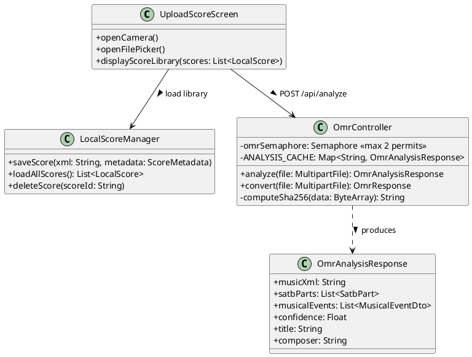

#### Transaction 1.1, Sequence Diagram

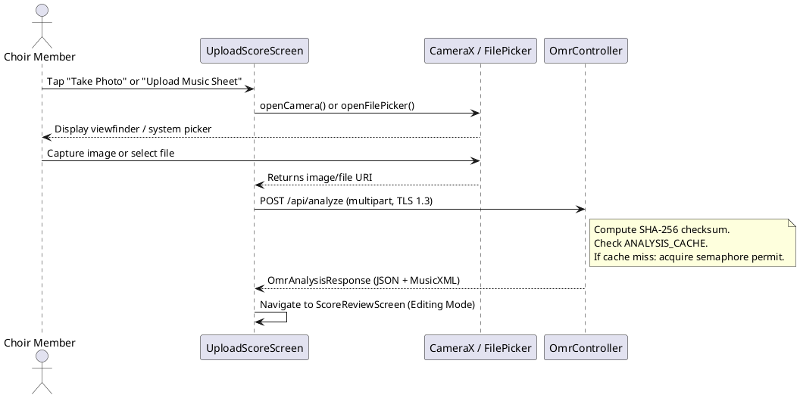

#### Data Design

No database write occurs during this transaction. The payload is in transit. `ANALYSIS_CACHE` is an in-memory `ConcurrentHashMap` on the server.

---

### 1.2 Transaction: Process Score via OMR Pipeline

#### User Interface Design

While the server processes the uploaded image, `UploadScoreScreen` displays a loading overlay informing the user that the score is being analyzed.

#### Back-end Component(s)

- **Component Name:** `OmrController` (OMR Processing Phase)
  - **Description:** After acquiring a semaphore permit, saves the uploaded file to a temp directory and invokes the Audiveris OMR subprocess via Java `ProcessBuilder`. Then calls `musicxml_cleaner.py` to normalize the XML, then calls `satb_analyzer.py` (music21) to classify SATB voices. The resulting `OmrAnalysisResponse` is cached and the semaphore permit is released.

- **Component Name:** Audiveris OMR Engine
  - **Description:** Java-based OMR engine executed as a system subprocess. Performs image deskewing, staff detection, note recognition, and exports raw MusicXML.
  - **CLI:** `java -jar audiveris.jar -batch -export -output <outDir> -- <inputFile>`

- **Component Name:** `musicxml_cleaner.py`
  - **Description:** Python post-processor that fixes semantic errors and normalizes Audiveris MusicXML output to W3C MusicXML 4.0 compliance.

- **Component Name:** `satb_analyzer.py` (music21)
  - **Description:** Python script using the `music21` library to classify voice parts as Soprano, Alto, Tenor, or Bass based on pitch range analysis. Outputs JSON with SATB assignments and `MusicalEvent` stream data.

**Audiveris Specifications (Updated):**

| Parameter | Detail |
| :--- | :--- |
| Invocation Mode | Java `ProcessBuilder` subprocess |
| CLI Arguments | `-batch -export -output <tempDir> -- <inputFile>` |
| Output Format | `.mxl` or `.musicxml` (passed to Python cleaner) |
| Concurrency Control | `Semaphore(2, fair=true)` in `OmrController` |
| Deduplication | SHA-256 checksum -> `ANALYSIS_CACHE` (ConcurrentHashMap) |

#### Transaction 1.2, Sequence Diagram

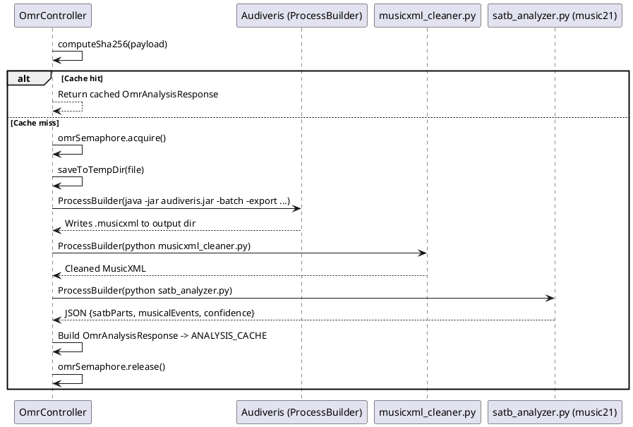

---

### 1.3 Transaction: Generate MusicXML & Interactive Score Review

#### User Interface Design

Upon receiving `OmrAnalysisResponse`, the app navigates immediately to **ScoreReviewScreen** (Editing Mode). This screen renders the MusicXML via OSMD inside `interactive_editor.html`. The user can tap any notehead to open `NoteEditorBottomSheet` and adjust pitch, octave, duration, or voice. Tapping "CONFIRM & SAVE" normalizes timing to TPQ=480 and saves locally.

#### Front-end Component(s)

- **Component Name:** `ScoreReviewScreen` (`ScoreReviewScreen.kt`)
  - **Description:** Interactive note editing screen loaded immediately after OMR processing or direct MusicXML import. Hosts the `interactive_editor.html` WebView.
  - **Component type:** Jetpack Compose Screen (Kotlin)

- **Component Name:** `NoteEditorBottomSheet` (`NoteEditorBottomSheet.kt`)
  - **Description:** Modal bottom sheet with pitch (C-B), octave, and duration chips, plus "Delete Note." Opens on notehead tap via `VoxSightJsBridge`.
  - **Component type:** Jetpack Compose ModalBottomSheet (Kotlin)

- **Component Name:** `interactive_editor.html`
  - **Description:** WebView-hosted interactive score editor using OSMD. Listens for touch events on noteheads, posts coordinates to Kotlin via `VoxSightJsBridge`, and re-engraves the measure after edits.
  - **Component type:** HTML5 + JavaScript (OSMD)

#### Back-end Component(s)

- **Component Name:** `LocalScoreManager` (`LocalScoreManager.kt`)
  - **Description:** On "CONFIRM & SAVE," normalizes all event timing to STANDARD_TPQ = 480, then caches the finalized `ScoreMetadata` and MusicXML string to Android's internal app storage.
  - **Component type:** Kotlin utility class / File I/O

#### Transaction 1.3, Class Diagram

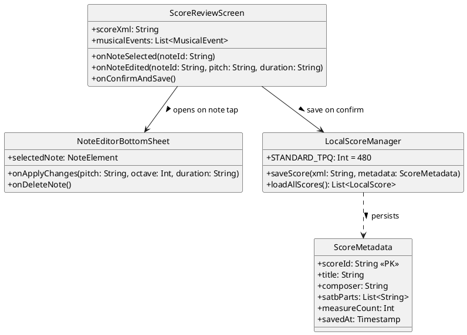

#### Transaction 1.3, Sequence Diagram

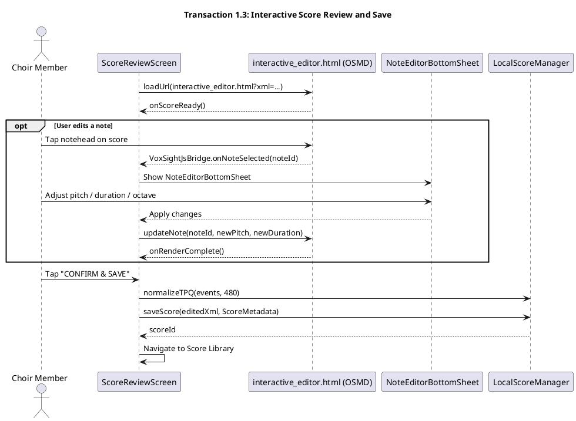

#### Data Design: Module 1 ERD

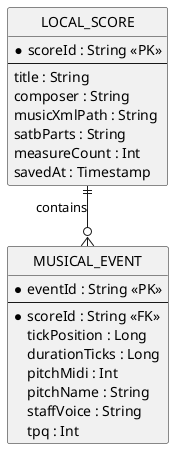

---

## Module 2.

### 2.1 Transaction: Select Voice Part and Apply Focus

#### User Interface Design

The **PracticeScreen** displays SATB part selector chips (S, A, T, B). Tapping a chip sets that part as "active." The selected staff renders at 100% opacity; non-selected staves are dimmed to <=20% opacity via CSS injection in `renderer.html`.

#### Front-end Component(s)

- **Component Name:** SATB Part Selector Chips (PracticeScreen)
  - **Description:** Four interactive Compose chips. Captures vocal part selection and updates `PracticeViewModel` state.
  - **Component type:** Jetpack Compose UI (Kotlin)

- **Component Name:** `MidiPlaybackEngine` (`MidiPlaybackEngine.kt`)
  - **Description:** Compose orchestrator that initializes `NativePlaybackEngine`, `SyncManager`, and the `renderer.html` WebView. Exposes `MidiPlayerController` to `PracticeScreen`.
  - **Component type:** `@Composable` Kotlin function

- **Component Name:** `renderer.html` (OSMD WebView)
  - **Description:** WebView-hosted production score renderer. Renders SATB parts with opacity-based focus using CSS. Hosts the 60 FPS HTML5 Canvas overlay for real-time note highlighting.
  - **Component type:** HTML5 + JavaScript (OSMD + Canvas)

#### Transaction 2.1, Sequence Diagram

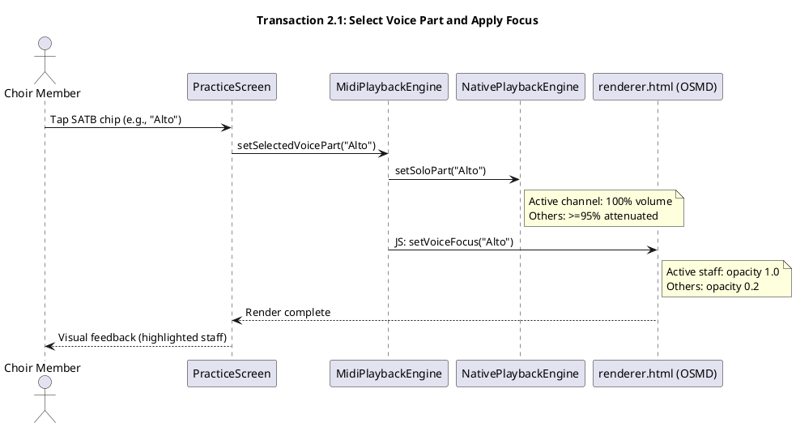

---

### 2.2 Transaction: Play Assigned Part (Native MIDI)

> **Revision Note:** The original design specified Tone.js in WebView using Aahs/Oohs soundfonts. This was abandoned due to unacceptable audio latency. The final implementation uses **native Android MIDI via `NativePlaybackEngine.kt`** with GM Piano (program 0). The WebView has zero audio responsibility.

#### Front-end Component(s)

- **Component Name:** `NativePlaybackEngine` (`NativePlaybackEngine.kt`)
  - **Description:** Core audio engine. Uses Android `MidiManager` to open a virtual MIDI device. Schedules MIDI NOTE_ON/NOTE_OFF via a coroutine microsecond pacing loop. Supports mute/solo per SATB channel, tempo changes, drift correction (DRIFT_WARN_MS=50). Uses GM Piano (DEFAULT_PROGRAM=0, DEFAULT_VELOCITY=80). Coalesces simultaneous events within an 8ms window (COALESCE_WINDOW_MS=8L).
  - **Component type:** Kotlin class (Native Android MIDI)

- **Component Name:** `MidiPlayerController` (interface)
  - **Description:** Exposes `play()`, `pause()`, `resume()`, `seekTo(tickPosition)`, `setTempo(bpm)`, `muteTrack(voice, muted)` to `PracticeScreen`.
  - **Component type:** Kotlin interface

#### Transaction 2.2, Class Diagram

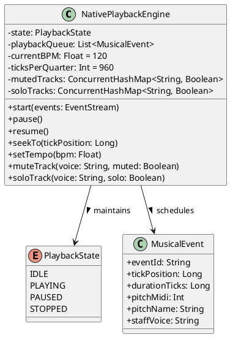

#### Transaction 2.2, Sequence Diagram

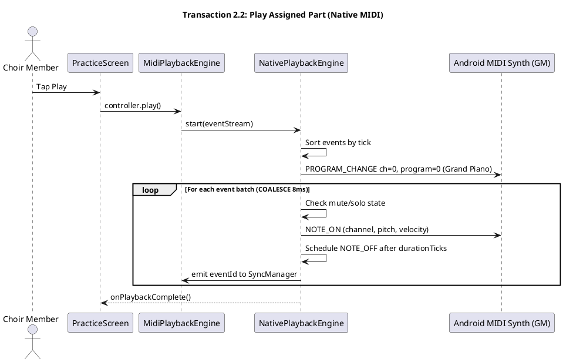

---

### 2.3 Transaction: Toggle Audio Suppression / Visual Focus

#### Front-end Component(s)

- **Component Name:** Visual Focus Toggle (PracticeScreen)
  - **Description:** Compose Switch that broadcasts focus state to `renderer.html` via JavaScript.
  - **Component type:** Jetpack Compose Switch

- **Component Name:** Mute/Solo Buttons (SATB Voice Cards)
  - **Description:** Per-voice mute and solo controls calling `NativePlaybackEngine.muteTrack()` / `soloTrack()`.
  - **Component type:** Jetpack Compose IconButton

#### Transaction 2.3, Sequence Diagram

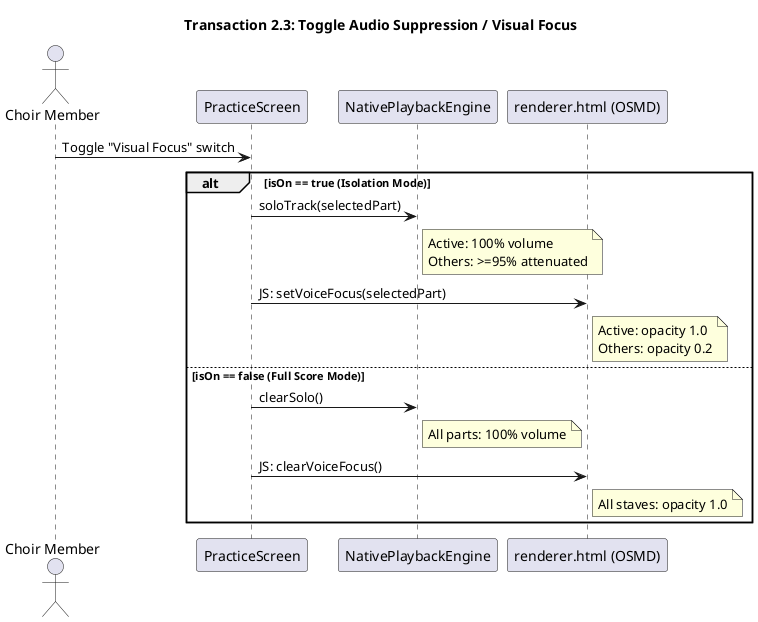

---

## Module 3.

### 3.1 Transaction: Initiate Playback with Tracking

#### User Interface Design

`PracticeScreen` embeds `renderer.html` via `MidiPlaybackEngine`. `SyncManager` correlates event IDs from `NativePlaybackEngine` to pre-computed notehead screen coordinates, instructing the Canvas to draw animated SATB-colored glow auras (Pink=Soprano, Purple=Alto, Blue=Tenor, Green=Bass). Auto-scroll keeps the active measure centered.

#### Front-end Component(s)

- **Component Name:** `renderer.html`
  - **Description:** Hosts OSMD score display and the 60 FPS Canvas overlay. Receives note coordinates from `SyncManager` and draws animated glow highlights. Handles auto-scroll.
  - **Component type:** HTML5 + JavaScript (OSMD + Canvas)

- **Component Name:** `VoxSightJsBridge`
  - **Description:** `@JavascriptInterface`-annotated Kotlin class bridging native Android and WebView JS context. Functions: (1) receives notehead bounding boxes from OSMD as JSON `[{x, y, w, h, voice}]`; (2) relays `highlightNote(eventId)` calls from `SyncManager` to Canvas; (3) reports `onScoreLoaded(measureCount)` back to `MidiPlaybackEngine`.
  - **Component type:** Kotlin `@JavascriptInterface` class

- **Component Name:** `SyncManager` (`SyncManager.kt`)
  - **Description:** Bipartite event correlator. At score load time, stores a map of `eventId -> OsmdNoteElement(x, y, w, h, voice)`. During playback, resolves screen coordinates from active `eventId` and instructs `renderer.html` to draw the highlight. Triggers auto-scroll.
  - **Component type:** Kotlin class

#### Back-end Component(s)

- **Component Name:** `MusicXmlParser` (within `MidiPlaybackEngine`)
  - **Description:** Reads locally stored MusicXML string. Produces an ordered `EventStream` of `MusicalEvent` objects consumed by `NativePlaybackEngine`.
  - **Component type:** Kotlin utility class (XML pull parser)

#### Transaction 3.1, Class Diagram

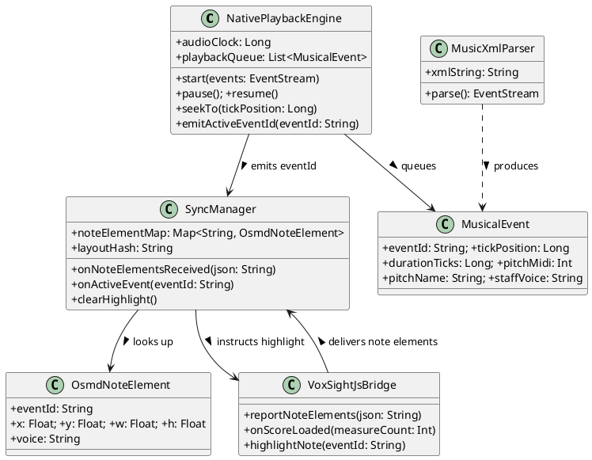

#### Transaction 3.1, Sequence Diagram

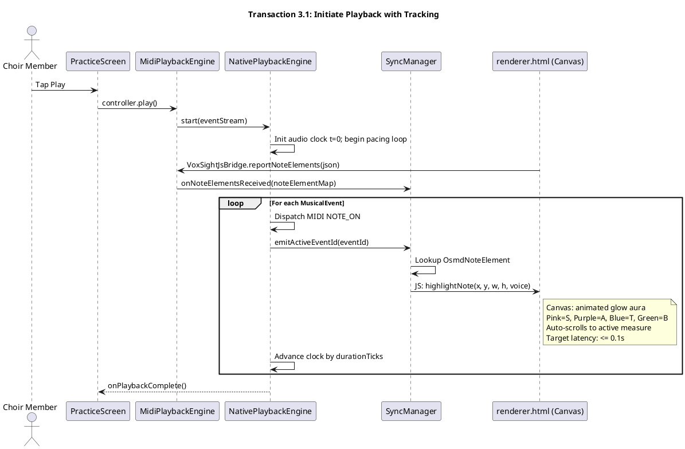

#### Data Design: Module 3 ERD

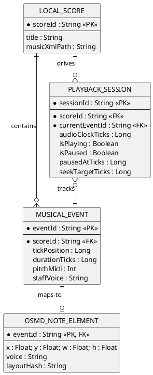

---

### 3.2 Transaction: Pause and Resume Tracking

#### User Interface Design

Tapping Pause freezes the audio clock and the Canvas highlight. The Play icon toggles to Resume. Tapping any measure while paused triggers a seek: `SyncManager` resolves the tapped coordinates to an `eventId`, and `NativePlaybackEngine` resumes from that tick.

#### Front-end Component(s)

- **Component Name:** Play/Pause/Resume Transport Bar
  - **Description:** Manages Playing/Paused/Resumed states. Dispatches `pause()` and `resume()` to `MidiPlayerController`. Swaps Play icon for Resume icon when paused.
  - **Component type:** Jetpack Compose Stateful Component

- **Component Name:** Frozen Highlight State (Canvas)
  - **Description:** When paused, the Canvas switches from animated glow to a static outlined border on the last active note.
  - **Component type:** JavaScript Canvas (renderer.html)

- **Component Name:** Seek Tap Handler
  - **Description:** While paused, detects taps on the WebView and forwards coordinates to `SyncManager` for measure-based seeking.
  - **Component type:** Jetpack Compose `Modifier.pointerInput`

#### Back-end Component(s)

- **Component Name:** `NativePlaybackEngine` (Pause/Resume/Seek)
  - **Description:** On `pause()`, freezes the coroutine pacing loop and records `pausedAtTick`. On `resume()`, restarts from `pausedAtTick`. On `seekTo(tickPosition)`, moves the playback pointer, clears pending MIDI notes, and resumes.
  - **Component type:** Kotlin class (extension of core `NativePlaybackEngine`)

#### Transaction 3.2, Class Diagram

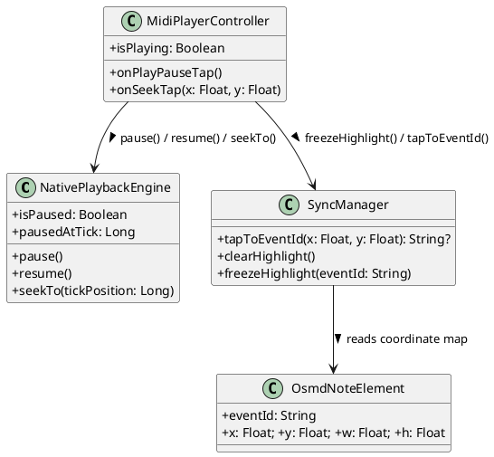

#### Transaction 3.2, Sequence Diagram

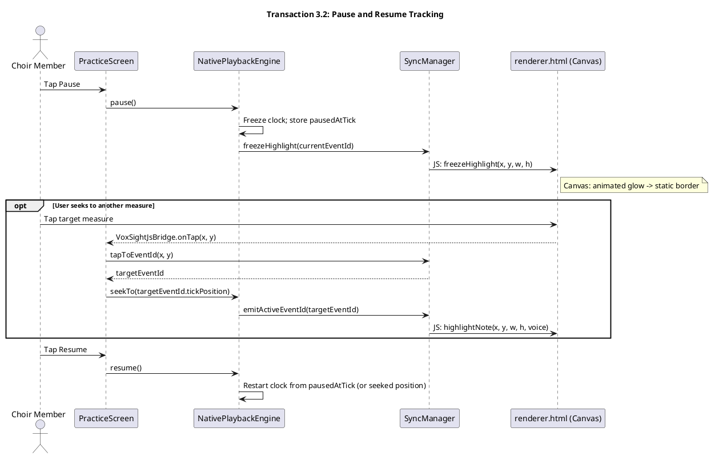

---

## Module 4.

### 4.1 Transaction: Sight-Reading Practice (Pitch Feedback)

#### User Interface Design

`SelectPracticeModeModal` (`SelectPracticeModeModal.kt`) gates the practice session, offering "Listen & Study" (mic disabled) and "Test Pitch & Practice" (mic active). If "Test Pitch" is selected, the system verifies `RECORD_AUDIO` permission. During playback, `PitchFeedbackIndicator` renders a horizontal animated deviation meter. After the session, `PracticeSummaryScreen` shows accuracy metrics and flagged measures.

#### Front-end Component(s)

- **Component Name:** `SelectPracticeModeModal` (`SelectPracticeModeModal.kt`)
  - **Description:** Gatekeeper modal presenting "Listen & Study" and "Test Pitch & Practice" mode cards before loading `PracticeScreen`.
  - **Component type:** Jetpack Compose Dialog (Kotlin)

- **Component Name:** `PitchDetectionEngine` (`PitchDetectionEngine.kt`)
  - **Description:** Streams real-time PCM audio from `AudioRecord` at 44,100 Hz. Applies the **YIN pitch detection algorithm** (native Kotlin, no TarsosDSP). Emits detected Hz to `PitchComparator`.
  - **Component type:** Kotlin Native Audio class (AudioRecord + YIN)

- **Component Name:** `PitchComparator` (`PitchComparator.kt`)
  - **Description:** Singleton utility. Receives detected Hz and target note name. Converts target note to Hz via `calculateTargetFrequency()` (A4=440Hz). Calculates cents deviation: `1200 * log2(detectedHz / targetHz)`. Applies **Octave Normalization** (folds into [-600, +600] cents). Evaluates `isMatch` using `TOLERANCE_CENTS = 10f`. Produces `FeedbackResult` with `isMatch`, `deviationCents`, and `colorBand`.
  - **Component type:** Kotlin `object` (singleton utility)

- **Component Name:** `PitchFeedbackIndicator` (`PitchFeedbackIndicator.kt`)
  - **Description:** Compose Canvas rendering a horizontal deviation meter with spring-animated needle and 200ms tween color transitions. Three color bands confirmed in `PitchModels.kt ColorBand.fromCents()`: **Green <=+/-50c** (isMatch if also <=10c), **Yellow 51-100c**, **Red >100c**.
  - **Component type:** Jetpack Compose Canvas Component

- **Component Name:** `PracticeSummaryScreen` (`PracticeSummaryScreen.kt`)
  - **Description:** Post-session summary: circular accuracy gauge, In-Tune/Miss counts, average cents deviation, flagged measures list (below 70% threshold) with repeat drill buttons.
  - **Component type:** Jetpack Compose Screen (Kotlin)

#### Back-end Component(s)

> **Revision Note:** The original `SessionMetricsController` (POST /api/session/save -> Spring Data JPA -> Supabase) is not implemented. All pitch attempt data is stored **in-memory** during the session and aggregated at session end. No backend HTTP call is made for session metrics.

- **Component Name:** In-Memory Pitch Buffer (ViewModel)
  - **Description:** A `mutableListOf<PitchAttempt>` accumulating `PitchAttempt(measureNumber, targetHz, detectedHz, deviationCents, isMatch, timestampMs)` objects. `getSessionSummary()` aggregates these into summary metrics.
  - **Component type:** Kotlin in-memory list (ViewModel state)

#### Transaction 4.1, Class Diagram

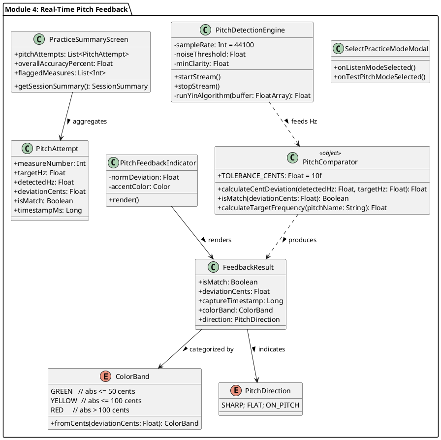

#### Transaction 4.1, Sequence Diagram

```plantuml
@startuml
title Transaction 4.1: Sight-Reading Practice (Pitch Feedback)

actor "Choir Member" as User
participant "SelectPracticeModeModal" as Modal
participant "PracticeScreen (ViewModel)" as UI
participant "PitchDetectionEngine (YIN)" as PDE
participant "PitchComparator" as PC
participant "NativePlaybackEngine" as NPE
participant "PitchFeedbackIndicator" as Indicator

User -> Modal : Select "Test Pitch & Practice"
Modal -> UI : Verify RECORD_AUDIO permission
alt Permission Denied
  UI --> User : Display rationale / fallback to Listen Mode
else Permission Granted
  UI -> PDE : startStream() at 44100 Hz
end

User -> UI : Tap Play
UI -> NPE : play()

loop Until playback ends or user pauses
  User -> PDE : Sings assigned vocal part
  PDE -> PDE : runYinAlgorithm(buffer)
  alt Noise too high / clarity too low
    PDE --> Indicator : PitchUiState.NoiseWarning
    Indicator --> User : Yellow noise warning
  else Valid vocal signal
    PDE -> NPE : Request current target note name
    NPE --> PDE : targetNoteName (e.g., "A4")
    PDE -> PC : calculateTargetFrequency("A4") -> 440.0 Hz
    PDE -> PC : calculateCentDeviation(detectedHz, 440.0)
    PC -> PC : Apply octave folding to [-600,+600]
    PC -> PC : fromCents(cents) -> ColorBand
    PC ..> PDE : FeedbackResult(isMatch, cents, colorBand)
    PDE --> Indicator : PitchUiState.Active(result)
    alt GREEN (abs <= 50c)
      Indicator --> User : Green needle (On Pitch, latency <=0.5s)
    else YELLOW (abs <= 100c)
      Indicator --> User : Yellow needle (Close, latency <=0.5s)
    else RED (abs > 100c)
      Indicator --> User : Red needle (Sharp/Flat, latency <=0.5s)
    end
    UI -> UI : buffer PitchAttempt(measure, targetHz, detectedHz, cents, match)
  end
end

UI -> UI : getSessionSummary(pitchAttempts)
UI -> UI : Navigate to PracticeSummaryScreen
@enduml
```

#### Data Design: Module 4 ERD

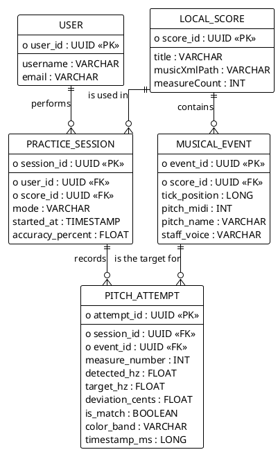
