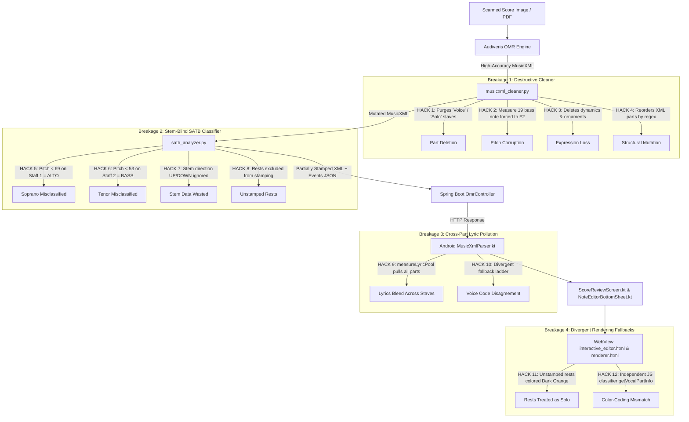

# VoxSight: Root Cause Analysis (RCA) and Phased Implementation Plan
## Preserving Audiveris OMR Fidelity and Resolving Vocal-Part Classification & Color-Coding Inaccuracies

> **Document Status**: Complete Root Cause Analysis & Proposed Implementation Plan (Awaiting Review & Approval)  
> **Investigation Date**: October 2026  
> **Scope**: Backend OMR Pipeline, Python Post-Processors, Android MusicXML Parser, Review Screen, and OSMD WebViews  

---

## Executive Summary

When identical sheet music is processed directly in **Audiveris** standalone, the resulting MusicXML transcription is **nearly 100% accurate**: staves, notes, accidentals, clefs, stems (`<stem>up</stem>` / `<stem>down</stem>`), dynamics, and lyrics faithfully match the printed score.

However, when that same sheet music is imported into **VoxSight**, severe inaccuracies appear:
1. **Pitches and notes are altered or deleted** (e.g., bass notes in Measure 19 are forcibly rewritten to F2; solo/voice staves are deleted entirely).
2. **Lyrics from one voice part bleed into completely different parts and rests** (e.g., Soprano lyrics appear under Bass notes and piano chords).
3. **Notes are consistently misclassified and incorrectly colored** (e.g., Sopranos singing below A4 become Alto; Tenors singing below F3 become Bass; rests are colored Dark Orange as "Baritone Solo").
4. **Users are forced into tedious manual note-by-note corrections** in the Note Editor to re-assign voice parts that Audiveris had already accurately captured.

### Root Cause Conclusion
**Audiveris is NOT the source of these errors.** The deviations are introduced downstream by:
1. **Destructive heuristics and hardcoded hacks in `musicxml_cleaner.py`** (stripping parts, overwriting pitches, deleting dynamics).
2. **Flawed, stem-blind classification heuristics in `satb_analyzer.py`** (using rigid pitch thresholds instead of XML stem direction, and blind divisi/unison assumptions).
3. **Cross-part lyric pooling pollution in `MusicXmlParser.kt`** (copying lyrics across distinct parts at matching tick onsets).
4. **Four independent, divergent classification engines** (`satb_analyzer.py`, `MusicXmlParser.kt`, `ScoreReviewScreen.kt`, and `renderer.html` / `interactive_editor.html`) that disagree whenever notes are unstamped or ambiguous.

---

## 1. End-to-End Pipeline & Error Injection Map

The diagram below traces the path of sheet music data through VoxSight and identifies the exact points where errors are injected:



---

## 2. Confirmed Root Causes & Technical Evidence

### Root Cause 1: Destructive Deletions and Score-Specific Hacks in `musicxml_cleaner.py`

| File | Affected Lines | Mechanism & Evidence | Musical Consequence |
| :--- | :--- | :--- | :--- |
| [`musicxml_cleaner.py`](file:///c:/Projects/VoxSight/voxsight/scripts/musicxml_cleaner.py) | **Lines 249–260, 349–351** (`reconcile_choral_parts`) | Staves named `"Voice"`, `"Vocal"`, `"Solo"`, `"Lead"`, or `"Part"` are flagged by `is_stray_voice_name(name)`. The script copies non-rest measures into Soprano 2 and then **unconditionally removes the entire part from the MusicXML tree** (`root.remove(p_stray)` and `p_list_elem.remove(sp_stray)`). | When Audiveris correctly outputs a Solo or Vocal staff, `musicxml_cleaner.py` permanently purges it from the score! |
| [`musicxml_cleaner.py`](file:///c:/Projects/VoxSight/voxsight/scripts/musicxml_cleaner.py) | **Lines 453–471** (`fix_bass_cadence_whole_notes`) | Hardcoded hack: `if m_num == '19': step_el.text = 'F'; oct_el.text = '2'`. Also forces any whole note on F with octave $\ge$ 3 to octave 2. | In Measure 19 of **every single score**, any bass note is forcibly rewritten to F2, regardless of what the composer wrote or Audiveris recognized! |
| [`musicxml_cleaner.py`](file:///c:/Projects/VoxSight/voxsight/scripts/musicxml_cleaner.py) | **Lines 1060–1066, 1096–1097, 1163–1164** | Searches for `"awit ng paghahangad"`, `"paghahangad"`, or `"borela"`. If found, or if intro measures exist before polyphony, it forces part names to `"Baritone Solo"`. | Overrides legitimate Solo and SATB voice identities with a hardcoded song-specific label. |
| [`musicxml_cleaner.py`](file:///c:/Projects/VoxSight/voxsight/scripts/musicxml_cleaner.py) | **Lines 746–776** (`clean_musicxml_tree`) | Unconditionally removes all `<dynamics>` (p, f, mf, mp, pp, ff) and sound dynamics attributes. Also strips all ornaments (`trill-mark`, `mordent`, `turn`, `shake`, `tremolo`). | Strips all dynamics and ornaments that Audiveris accurately transcribed. |
| [`musicxml_cleaner.py`](file:///c:/Projects/VoxSight/voxsight/scripts/musicxml_cleaner.py) | **Lines 357–419** (`harmonize_choral_key_signatures`) | Overwrites key signatures across parts in measures based on a majority vote. | Corrupts polytonal scores or measures where individual parts have legitimate accidentals/key changes. |
| [`musicxml_cleaner.py`](file:///c:/Projects/VoxSight/voxsight/scripts/musicxml_cleaner.py) | **Lines 1573–1616** (`_get_sort_rank`) | Physically reorders `<part>` elements in the MusicXML file based on regex rank patterns. | Rearranges score staves, breaking original score layout and vertical alignment. |

---

### Root Cause 2: Stem-Blind SATB Classification & Stamping Failures in `satb_analyzer.py`

| File | Affected Lines | Mechanism & Evidence | Musical Consequence |
| :--- | :--- | :--- | :--- |
| [`satb_analyzer.py`](file:///c:/Projects/VoxSight/voxsight/scripts/satb_analyzer.py) | **Lines 1605–1635** (`Global SATB optimization`) | In 2-staff choral scores (Staff 1: S/A, Staff 2: T/B), when a single melody note appears on Staff 1, it checks: <br>`if pitch >= 69: S=0.8, A=0.2 else S=0.2, A=0.8`<br>On Staff 2, it checks: <br>`if pitch >= 53: T=0.8, B=0.2 else T=0.2, B=0.8` | **Sopranos singing below A4 (G4, F4, E4, D4, C4) are misclassified as Alto!** <br>**Tenors singing below F3 (E3, D3, C3) are misclassified as Bass!** <br>**Basses singing above F3 are misclassified as Tenor!** |
| [`satb_analyzer.py`](file:///c:/Projects/VoxSight/voxsight/scripts/satb_analyzer.py) | **Ignored: `<stem>` tags** | Choral engraving standard: **Staff 1: Stem UP = Soprano, Stem DOWN = Alto; Staff 2: Stem UP = Tenor, Stem DOWN = Bass.** Audiveris faithfully transcribes `<stem>up</stem>` and `<stem>down</stem>`. `satb_analyzer.py` ignores stem direction and relies on static pitch thresholds! | Ignores the single most reliable notation cue for choral voice separation. |
| [`satb_analyzer.py`](file:///c:/Projects/VoxSight/voxsight/scripts/satb_analyzer.py) | **Lines 1220–1225** (`detect_unisons_and_divisi`) | Heuristic: `if len(s1_notes) >= 2 and len(s2_notes) == 1 -> s2_notes[0]['satb_voice'] = 'UNISON_TB'`. | If Tenor is resting and Bass is singing alone, the note is falsely tagged as a Tenor/Bass unison! If Soprano is resting and Alto sings alone, it is falsely tagged as a Soprano/Alto unison! |
| [`satb_analyzer.py`](file:///c:/Projects/VoxSight/voxsight/scripts/satb_analyzer.py) | **Lines 742–745** (`prescan_musicxml`) | `if is_rest: continue`. Rest notes are explicitly skipped during pre-scanning and are **never stamped with `data-vx-voice`**. | Downstream renderers receive unstamped rests and fall back to part-level defaults, causing rests to be classified and colored as "Baritone Solo" (Dark Orange). |
| [`satb_analyzer.py`](file:///c:/Projects/VoxSight/voxsight/scripts/satb_analyzer.py) | **Lines 820–1060** (`match_and_stamp_voices`) | The 9-step matching between `music21` objects and ElementTree XML fails on grace notes, ties, tuplets, or measure offsets, leaving notes unstamped. | Any unstamped note drops into divergent fallback ladders in the Android app. |

---

### Root Cause 3: Cross-Part Lyric Pooling Pollution in `MusicXmlParser.kt`

| File | Affected Lines | Mechanism & Evidence | Musical Consequence |
| :--- | :--- | :--- | :--- |
| [`MusicXmlParser.kt`](file:///c:/Projects/VoxSight/mobile/app/src/main/java/com/cit/kaido/voxsight/ui/screens/practice/MusicXmlParser.kt) | **Lines 738–749 & 824–826** | `measureLyricPool` collects lyrics across **all parts** at every tick. Line 825: If a note has no lyric, it inherits `mPool[note.startTimeDivisions]`. | If Soprano sings a lyric while Bass holds a note or rests, or while Piano plays chords, the Soprano lyric is forcibly injected into the Bass and Piano notes! |
| [`MusicXmlParser.kt`](file:///c:/Projects/VoxSight/mobile/app/src/main/java/com/cit/kaido/voxsight/ui/screens/practice/MusicXmlParser.kt) | **Lines 769–820** (`isolatedVoice`) | Fallback logic for unstamped notes in 2-part scores: if `!isChordGroup`, note 1 on staff 1 is ALWAYS Soprano, note 1 on staff 2 is ALWAYS Tenor. | Disagrees with `satb_analyzer.py`'s pitch heuristics and causes voice flipping during playback. |

---

### Root Cause 4: Four Divergent Classification Engines & Color Resolution Disconnect

VoxSight currently maintains **four separate, unaligned voice classification implementations**:

```
[Audiveris Raw Score]
         │
         ├── 1. satb_analyzer.py (Python Backend)
         │      • Evaluates: Pitch ranges (C4-C6, F3-D5, C3-A4, C2-C4), nearest neighbor, pitch thresholds (69, 53)
         │      • Stamps: data-vx-voice attribute on XML <note> elements
         │
         ├── 2. MusicXmlParser.kt (Android Parser)
         │      • Evaluates: universalPartMap, chord sorting by MIDI pitch, hardcoded 2-part staff rules
         │      • Generates: MusicalEvent stream for audio playback
         │
         ├── 3. ScoreReviewScreen.kt (Android Review UI)
         │      • Evaluates: String pattern matching on customVoiceStr, score title keywords (isAwit), measure < 6 checks
         │      • Displays: Review chips, note editor modal
         │
         └── 4. renderer.html / interactive_editor.html (WebView Engraving)
                • Evaluates: getVocalPartInfo() / getVocalPartColor() with DOM queries, SVG notehead matching
                • Applies: Direct SVG fills and canvas glowing auras
```

#### Why Notes Are Miscolored and Require Manual Correction:
1. **Unstamped Notes Trigger Divergent Fallbacks**: If `satb_analyzer.py` fails to stamp a note (e.g., grace note, tuplet, rest, or tie), the 3 downstream components each guess differently:
   - `MusicXmlParser.kt` may call it Tenor.
   - `ScoreReviewScreen.kt` may call it Bass.
   - `renderer.html` may color it as Soprano or Solo.
2. **Rest Notes Colored as Baritone Solo (Dark Orange)**:
   - Because rests never get a `data-vx-voice` stamp, `renderer.html` falls back to Priority 2 (`getVocalPartInfo`).
   - If `musicxml_cleaner.py` renamed the part to `"Solo"` or `"Baritone Solo"` based on intro measures or `is_awit_score`, `renderer.html` colors every rest note on that staff with `#FF6D00` (Dark Orange).
3. **Color Palette Disconnect**:
   - `renderer.html` and `VoicePart.kt` previously lacked a unified, family-based color system. Noteheads, stems, tails, and canvas glow layers received mismatched color codes.

---

## 3. Data Flow & Component Breakdown Matrix

| Pipeline Stage | Component | Input | Transformation | Output | Error Injected? |
| :--- | :--- | :--- | :--- | :--- | :---: |
| **1. OMR Vision** | `AudiverisService.java` / `Audiveris.exe` | Score Image/PDF | Optical Music Recognition (OMR) | Raw MusicXML | ❌ **No (Accurate)** |
| **2. Post-OMR Clean** | `musicxml_cleaner.py` | Raw MusicXML | Part merging, dynamic stripping, pitch hacks | Modified MusicXML | ⚠️ **YES (Severe)** |
| **3. SATB Analysis** | `satb_analyzer.py` | Modified MusicXML | Pitch-based SATB scoring, unisons, XML stamping | Stamped MusicXML + JSON | ⚠️ **YES (Severe)** |
| **4. Backend REST** | `OmrController.java` | Stamped MusicXML + JSON | Bundles into `OmrAnalysisResponse` | JSON Response | ❌ No |
| **5. Mobile Parsing** | `MusicXmlParser.kt` | MusicXML string | Standardizes TPQ=480, cross-part lyric pool | `MusicalEvent` list | ⚠️ **YES (Moderate)** |
| **6. Review UI** | `ScoreReviewScreen.kt` | Parsed score & events | Builds review UI, passes XML to WebView | Interactive Score View | ⚠️ **YES (Minor)** |
| **7. Note Editing** | `interactive_editor.html` | Stamped MusicXML | OSMD SVG rendering, note touch-tap, XML editing | Updated MusicXML string | ⚠️ **YES (Minor)** |
| **8. Playback Render** | `renderer.html` | Cleaned MusicXML | OSMD SVG engraving, SVG coloring, Canvas 60 FPS | Visual Accompaniment | ⚠️ **YES (Minor)** |

---

## 4. Prioritized, Phased Implementation Plan

### Phase 1: Audiveris Fidelity & Sanitizer Neutralization
**Goal**: Ensure VoxSight receives 100% of Audiveris's accurate transcription without destructive alterations.

* **Target File**: [`voxsight/scripts/musicxml_cleaner.py`](file:///c:/Projects/VoxSight/voxsight/scripts/musicxml_cleaner.py)
* **Tasks**:
  1. **Disable Part Purging in `reconcile_choral_parts`**:
     - Remove `root.remove(p_stray)` and `p_list_elem.remove(sp_stray)`.
     - Staves named `"Voice"`, `"Solo"`, or `"Vocal"` must be **preserved as valid parts**, never merged into Soprano 2 and deleted.
  2. **Remove Measure 19 F2 Override and Cadence Pitch Hack**:
     - Completely delete `fix_bass_cadence_whole_notes` (lines 422–472). No note pitch or octave may ever be hardcoded based on measure numbers.
  3. **Remove Hardcoded Song Checks**:
     - Remove all occurrences of `is_awit_score` (`"awit ng paghahangad"`, `"paghahangad"`, `"borela"`). Score processing must be 100% score-agnostic.
  4. **Preserve Dynamics & Musical Ornaments**:
     - Remove lines 744–776 that strip `<dynamics>` and `<notations>` ornaments (`trill-mark`, `mordent`, `turn`).
  5. **Preserve Original Score Part Order & Key Signatures**:
     - Disable `_get_sort_rank` part reordering (lines 1573–1616). Preserve the exact part ordering from Audiveris.
     - Remove `harmonize_choral_key_signatures` (lines 357–419).

---

### Phase 2: Stem-Aware SATB & Divisi Classification Engine
**Goal**: Make vocal-part classification deterministic, accurate, and faithful to standard choral engraving rules.

* **Target File**: [`voxsight/scripts/satb_analyzer.py`](file:///c:/Projects/VoxSight/voxsight/scripts/satb_analyzer.py)
* **Tasks**:
  1. **Implement Stem-Direction-First Classification for 2-Staff Choral Scores**:
     - Replace static pitch thresholds (69 and 53) in lines 1605–1635:
       - **Staff 1 (Treble)**: If `<stem>up</stem>` $\rightarrow$ assign **Soprano (`S`)**; if `<stem>down</stem>` $\rightarrow$ assign **Alto (`A`)**.
       - **Staff 2 (Bass)**: If `<stem>up</stem>` $\rightarrow$ assign **Tenor (`T`)**; if `<stem>down</stem>` $\rightarrow$ assign **Bass (`B`)**.
       - Only if stems are missing or directionless (e.g. whole notes), use contrapuntal voice-leading continuity (`c_scores`) rather than hard pitch cutoffs.
  2. **Eliminate Blind Divisi / Unison Assumptions**:
     - Remove lines 1220–1225 (`if len(s1) >= 2 and len(s2) == 1 -> UNISON_TB`).
     - A note is only a Unison if:
       - Two notes share identical start tick and pitch on the same staff, OR
       - A note has two stems (up & down) on a single notehead, OR
       - The score contains an explicit *"unis."* or *"a2"* direction.
  3. **Neutral Handling for Rest Notes**:
     - Rest notes must be marked with a neutral tag (`data-vx-voice="REST"` or omitted from vocal scoring) so they are **never colored as Solo or Baritone Solo**.
  4. **Guarantee 100% Stamping Coverage**:
     - Fix matching between `music21` events and ElementTree XML to ensure every sounding note receives its exact `data-vx-voice` attribute.

---

### Phase 3: Lyric Integrity & Parser Normalization
**Goal**: Eliminate cross-part lyric pollution while preserving homophonic chord text.

* **Target File**: [`mobile/app/src/main/java/com/cit/kaido/voxsight/ui/screens/practice/MusicXmlParser.kt`](file:///c:/Projects/VoxSight/mobile/app/src/main/java/com/cit/kaido/voxsight/ui/screens/practice/MusicXmlParser.kt)
* **Tasks**:
  1. **Eliminate Cross-Part `measureLyricPool`**:
     - Remove lines 738–749 and 824–826.
     - Lyric inheritance must be strictly restricted to the **same voice and staff** (e.g. within a chord group on the same part).
     - Under no circumstances may a lyric from Part 1 (Soprano) be copied onto Part 4 (Bass) or Part 5 (Accompaniment).
  2. **Align Fallback Logic with `satb_analyzer.py`**:
     - Update lines 769–820 to honor `data-vx-voice` as the single authoritative source of truth.

---

### Phase 4: Unified Voice Resolution Contract & Color Palette
**Goal**: Unify all presentation layers under a single voice contract and apply the user's family-based color palette.

* **Target Files**:
  - [`mobile/app/src/main/java/com/cit/kaido/voxsight/model/VoicePart.kt`](file:///c:/Projects/VoxSight/mobile/app/src/main/java/com/cit/kaido/voxsight/model/VoicePart.kt)
  - [`mobile/app/src/main/java/com/cit/kaido/voxsight/ui/screens/upload/ScoreReviewScreen.kt`](file:///c:/Projects/VoxSight/mobile/app/src/main/java/com/cit/kaido/voxsight/ui/screens/upload/ScoreReviewScreen.kt)
  - [`mobile/app/src/main/assets/renderer.html`](file:///c:/Projects/VoxSight/mobile/app/src/main/assets/renderer.html)
  - [`mobile/app/src/main/assets/interactive_editor.html`](file:///c:/Projects/VoxSight/mobile/app/src/main/assets/interactive_editor.html)
* **Tasks**:
  1. **Unified Token Vocabulary**:
     - Single canonical token set: `S`, `S1`, `S2`, `A`, `A1`, `A2`, `T`, `T1`, `T2`, `B`, `B1`, `B2`, `UNISON_SA`, `UNISON_TB`, `TUTTI`, `SOLO`, `OTHERS`.
  2. **Strict Guard Against Coloring Rests**:
     - In both `renderer.html` and `interactive_editor.html`, ensure rest elements (`isRest === true`) are strictly skipped from receiving any vocal color fill.
  3. **Restore Family-Based Visual Palette**:
     - Apply distinct shades within each vocal family:
       - **Soprano Family (Rose/Pink)**: Soprano (`#E11D48`), Soprano 1 (`#FB7185`), Soprano 2 (`#881337`)
       - **Alto Family (Purple)**: Alto (`#8E24AA`), Alto 1 (`#C084FC`), Alto 2 (`#4C1D95`)
       - **Tenor Family (Blue)**: Tenor (`#2563EB`), Tenor 1 (`#0284C7`), Tenor 2 (`#1E3A8A`)
       - **Bass Family (Green)**: Bass (`#16A34A`), Bass 1 (`#65A30D`), Bass 2 (`#064E3B`)
       - **Solo**: Unified Tangerine Orange (`#FF6D00`) for all solo designations
       - **Accompaniment / Others**: Slate Grey (`#546E7A`)
       - **Unisons**: Blended tones (e.g. S/A Unison `#4F46E5`, T/B Unison `#0D9488`, Tutti `#CA8A04`)

---

### Phase 5: Regression Test Suite & End-to-End Validation
**Goal**: Verify that identical scores imported into Audiveris and VoxSight maintain complete fidelity.

* **Target Files**:
  - [`voxsight/scripts/tests/`](file:///c:/Projects/VoxSight/voxsight/scripts/tests/)
  - [`mobile/app/src/test/java/com/cit/kaido/voxsight/`](file:///c:/Projects/VoxSight/mobile/app/src/test/java/com/cit/kaido/voxsight/)
* **Test Fixtures & Scenarios**:
  1. **Test Score 1: Standard 4-Staff Open SATB**:
     - Verify all 4 vocal parts are preserved in exact score order.
     - Verify no parts are merged or deleted.
     - Verify dynamics (p, f, mf) remain intact.
  2. **Test Score 2: Condensed 2-Staff Choral (Treble = S/A, Bass = T/B)**:
     - Verify Soprano melody singing below A4 (e.g. E4, F4, G4) with stem UP is classified as **Soprano**, NOT Alto.
     - Verify Tenor singing below F3 (e.g. D3, E3) with stem UP is classified as **Tenor**, NOT Bass.
  3. **Test Score 3: Score with Measure 19**:
     - Verify Measure 19 notes retain their original composer pitches and are NOT rewritten to F2.
  4. **Test Score 4: Solo + SATB Choir**:
     - Verify Solo line is retained as a distinct part and colored Orange.
     - Verify Solo lyrics do NOT bleed onto choir staves or rests.
     - Verify rests are NOT colored Dark Orange.
  5. **Test Score 5: Divisi & Unison**:
     - Verify S1/S2 and B1/B2 divisi maintain their family colors.
     - Verify same-staff unisons between subdivisions use core voice color.

---

## 5. Objective Acceptance Criteria

| # | Criterion | Verification Method | Target Status |
| :---: | :--- | :--- | :--- |
| **AC-1** | **Audiveris Part Preservation** | Compare raw Audiveris MusicXML part count with VoxSight cleaned MusicXML part count. | `part_count` matches 100%; zero staves deleted. |
| **AC-2** | **Pitch Integrity** | Inspect pitch elements in Measure 19 across all parts. | 0% forced F2 pitch mutations; all pitches match original score. |
| **AC-3** | **Dynamics & Expression Preservation** | Check for presence of `<dynamics>` elements in output MusicXML. | All dynamics (`p`, `f`, `mf`, `mp`, cresc.) preserved. |
| **AC-4** | **Stem-Aware SATB Classification** | Test condensed 2-staff scores with low Soprano notes (G4/F4) and low Tenor notes (D3/E3). | Stem UP on Staff 1 = 100% Soprano; Stem UP on Staff 2 = 100% Tenor. |
| **AC-5** | **Zero Cross-Part Lyric Bleed** | Check lyrics in Bass and Accompaniment parts during Soprano/Solo phrases. | 0 Soprano lyrics injected into Bass or Accompaniment. |
| **AC-6** | **Rest Note Neutrality** | Inspect rest elements rendered in OSMD WebViews. | 0 rests colored with vocal part colors (e.g. no Dark Orange rests). |
| **AC-7** | **Family Color-Coding Parity** | Verify notehead, stem, and glowing aura colors across Review, Editor, and Playback screens. | 100% visual parity across all screens using family palette. |
| **AC-8** | **Elimination of Manual Corrections** | Load test scores in the app and inspect note assignments before user touch-editing. | Accurate part assignment out-of-the-box; zero required user edits. |
